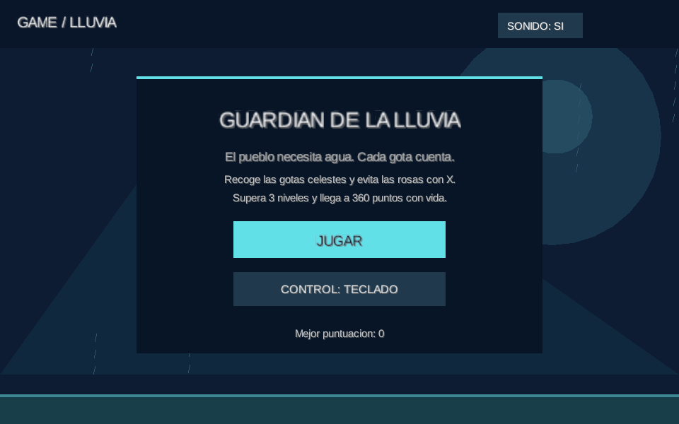
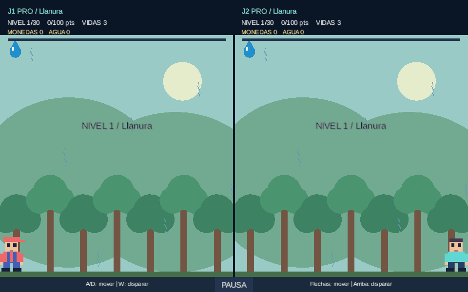

# GameLluvia — Guardián de la lluvia

Proyecto de Programación Avanzada desarrollado en **Java y LibGDX**, a partir de GameLluvia2024 entregado por el profesor. Recolecta agua, supera 30 niveles y utiliza el agua acumulada para vencer al OVNI.

**Integrantes:** Matías Santelices S., Rodrigo Escudero y Ariel Fuenzalida.
**Entrega:** 23 de octubre de 2026.

## Documentos para revisar primero

Los dos PDF finales están en esta misma carpeta, junto al README:

1. **[Informe del proyecto](01-Informe-GameLluvia.pdf)**.
2. **[Manual de usuario](02-Manual-de-Usuario-GameLluvia.pdf)**.

Las carpetas `informe` y `manual` conservan las fuentes editables y sus copias de los documentos.

## Descargar el trabajo completo

La rama para entregar es **[entrega-final](https://github.com/maverick1006/Proyecto-Game-LLuvia-/tree/entrega-final)**. En GitHub selecciona esa rama y pulsa **Code > Download ZIP**. Descomprime el archivo antes de abrir el proyecto.

El ZIP de la rama incluye:

- **[Proyecto listo para Eclipse](entrega/GameLluvia-Eclipse.zip)**: descomprime este ZIP adicional e importa `GameLluvia` como **General > Existing Projects into Workspace**. Lleva LibGDX y sus dependencias incluidas.
- **[Juego ejecutable Desktop](entrega/GameLluvia.jar)**, con [lanzador Windows](entrega/JUGAR_JAR.bat).
- **[APK Android de prueba](entrega/GameLluvia-Android-debug.apk)**: compilado; prueba en teléfono pendiente.
- **[Informe ejecutivo PDF](01-Informe-GameLluvia.pdf)** y **[manual de usuario PDF](02-Manual-de-Usuario-GameLluvia.pdf)**, con fuentes LaTeX y anexos de instalación.
- Fuentes Java, pruebas, UML, recursos, Gradle Wrapper y guías.

**[Leer primero](entrega/LEER_PRIMERO.md)** | **[Pasos para Eclipse](ABRIR_EN_ECLIPSE.md)** | **[Android Studio](docs/ANDROID_STUDIO.md)**

## Contenido

- [Instalación y requisitos](#instalación-y-requisitos)
- [Abrir y ejecutar en Eclipse](#abrir-y-ejecutar-en-eclipse)
- [Ejecutar por consola](#ejecutar-por-consola)
- [Generar y ejecutar el JAR](#generar-y-ejecutar-el-jar)
- [Juego y controles](#juego-y-controles)
- [Organización y patrones](#organización-y-patrones)
- [Pruebas y plataformas](#pruebas-y-plataformas)
- [Documentación de entrega](#documentación-de-entrega)

## Instalación y requisitos

- **JDK 17**, configurado en `JAVA_HOME`. El código se compila con compatibilidad Java 11; para reproducir nuestro entorno usamos JDK 17.
- **Gradle Wrapper 8.10.1**, incluido en el repositorio. No hace falta instalar Gradle por separado.
- **LibGDX 1.12.1**, descargado por Gradle.
- Para Eclipse: **Eclipse IDE for Java Developers**, con **Buildship (Gradle Integration)** y soporte para Java 17. Si la versión de Eclipse requiere otro Java para iniciar el IDE, su JVM de arranque es independiente del JDK 17 configurado para este proyecto y Gradle.
- Conexión a Internet para la primera resolución de dependencias al importar las fuentes Gradle. El ZIP específico para Eclipse ya incluye las bibliotecas, mediante rutas relativas.

Para obtener directamente la rama correcta por Git:

```bash
git clone --branch entrega-final https://github.com/maverick1006/Proyecto-Game-LLuvia-.git GameLluvia
cd GameLluvia
```

La raíz descargada conserva el proyecto Gradle; la carpeta `entrega` contiene las versiones preparadas para evaluar y ejecutar.

## Abrir y ejecutar en Eclipse

**Para el profesor:** utiliza `GameLluvia-Eclipse.zip`. Incluye fuentes, recursos, bibliotecas y configuración Java portátil. No requiere Android SDK ni descargar LibGDX para ejecutarlo.

1. Descomprime el ZIP fuera del workspace.
2. **File > Import > General > Existing Projects into Workspace**.
3. Selecciona la carpeta `GameLluvia`, marca el proyecto y pulsa **Finish**.
4. Abre `lwjgl3/src/main/java/puppy/code/lwjgl3/Lwjgl3Launcher.java` y usa **Run As > Java Application**. Selecciona **GameLluvia** si lo solicita.

[Pasos completos y solución de problemas](ABRIR_EN_ECLIPSE.md). La configuración compartida usa la carpeta `assets` del workspace. El paquete conserva Java y LibGDX, con `core` y `lwjgl3` en sus carpetas originales.

**Fuentes de GitHub:** se importan mediante **Gradle > Existing Gradle Project**, raíz con `settings.gradle`, Wrapper y JDK 17. Requieren Internet inicialmente. Ejecuta **lwjgl3 > application > run** desde Gradle Tasks.

Para regenerar el paquete Eclipse: `.\gradlew.bat -Pandroid=false exportarEclipse`. Resultado: `build/distributions/GameLluvia-Eclipse.zip`. [Exportación desde el IDE](docs/ENTREGA_ECLIPSE.md).

### Si Eclipse no abre el proyecto

Puedes ejecutar la copia ya compilada desde la raíz descargada:

```powershell
java -jar .\entrega\GameLluvia.jar
```

En Windows también puedes usar `entrega/JUGAR_JAR.bat`. Requiere Java compatible; el entorno probado usa JDK 17. Esta alternativa no necesita Gradle ni Android SDK.

Para comprobar y compilar las fuentes de Desktop sin configurar Android:

```powershell
.\gradlew.bat -Pandroid=false :core:test :lwjgl3:dist
.\gradlew.bat -Pandroid=false :lwjgl3:run
```

Si falta un recurso, comprueba que descomprimiste la carpeta completa y revisa [la guía de Eclipse](ABRIR_EN_ECLIPSE.md). El proyecto Gradle debe importarse desde la raíz, no desde `core` ni `assets`.

## Android Studio

Abre la raíz con **File > Open**, configura SDK Platform 35 y Build-Tools 34.0.0, elige **Gradle JDK 17** y sincroniza. Android Studio escribe `sdk.dir` en `local.properties`; esto habilita el módulo Android automáticamente. No publiques ese archivo personal.

APK compilado correctamente el 23/10/2026: `.\gradlew.bat -Pandroid=true :android:assembleDebug`. [Instrucciones completas](docs/ANDROID_STUDIO.md). La entrega incluye `GameLluvia-Android-debug.apk`. La prueba en teléfono sigue pendiente; no se certifican todavía gestos, audio ni rendimiento Android.

## Ejecutar por consola

En PowerShell, desde la raíz:

```powershell
java -version
.\gradlew.bat :lwjgl3:run
```

Linux/macOS:

```bash
chmod +x gradlew
./gradlew :lwjgl3:run
```

El módulo de escritorio se llama **`lwjgl3`**: no existen las tareas `desktop:run` o `desktop:dist` en este proyecto. La ejecución Gradle configura los assets automáticamente.

## Generar y ejecutar el JAR

```powershell
.\gradlew.bat :core:test :lwjgl3:dist
java -jar .\lwjgl3\build\libs\GameLluvia.jar
```

En Linux/macOS, sustituye el wrapper por `./gradlew` y usa barras `/`. Para ejecutar el JAR en macOS, añade `-XstartOnFirstThread` antes de `-jar`.

**`GameLluvia.jar` contiene las clases, dependencias y assets.** Requiere Java; no incluye una JVM. No confundirlo con `lwjgl3.jar`, que es el JAR simple del módulo y no es el entregable autónomo.

También se puede generar una distribución con bibliotecas separadas:

```powershell
.\gradlew.bat :lwjgl3:installDist :lwjgl3:distZip
.\lwjgl3\build\install\lwjgl3\bin\lwjgl3.bat
```

Para esa alternativa se comparte toda la carpeta `lwjgl3/build/install/lwjgl3`, o el ZIP de `lwjgl3/build/distributions`. No se entrega solo el `.bat`.

## Juego y controles

La campaña recorre llanura (1–10), hielo (11–20) y Atacama (21–30). El agua suma puntos y munición. Cada 100 puntos permite avanzar; los peligros pueden restar progreso. Con 3000 puntos el OVNI lleva al jugador al espacio. Para vencerlo se disparan chorros de agua y se siguen recogiendo gotas para recargar.

- **Noob:** 5 vidas. **Pro:** 3. **Hacker:** 1. También cambian velocidad, frecuencia y peligrosidad de la lluvia.
- Tras cuatro segundos sin agua empieza la reducción de velocidad. Recoger agua restaura la hidratación.
- Hay mejoras temporales y perjuicios distintos según la zona, explicados en la guía dentro del juego.
- La tienda ofrece skins cosméticas por monedas y por logros. Completar la campaña y vencer al jefe desbloquea una recompensa exclusiva por dificultad.
- Cada nuevo hito de cinco niveles permite una ronda de monedas de ocho segundos.
- El menú esconde un combate contra el OVNI: ganarlo revela al alien. No modifica dinero, ranking ni niveles de campaña.
- El versus tiene pantalla dividida y teclado compartido. No requiere red ni modifica el perfil de campaña.

| Acción | Campaña | Versus |
|---|---|---|
| Mover | A/D o izquierda/derecha | J1: A/D; J2: izquierda/derecha |
| Disparar al jefe | Espacio o clic en la zona de juego | J1: W; J2: arriba |
| Pausar | P o Escape | P o Escape |
| Iniciar/reintentar | Enter o botones | Enter o botones |
| Sonido | M o botón | M o botón |
| Control alternativo | Botón del menú o T; ratón/táctil | Dos controles de teclado |

Las monedas, skins y puntuaciones se guardan **localmente**, sin cuenta en línea. El launcher usa `../guardado` respecto al directorio de trabajo; si ejecutas desde otra carpeta, puede utilizar otro guardado. No incluyas guardados personales en la entrega.




## Organización y patrones

| Carpeta | Contenido |
|---|---|
| `core` | Reglas, estados, dibujo, controles y perfil compartidos |
| `lwjgl3` | Launcher Desktop y prueba visual |
| `android` | Launcher Android y empaquetado APK; dispositivo pendiente |
| `assets` | Recursos de audio e imágenes de la base |
| `docs` | Reporte, auditoría, diagramas y capturas |

Los personajes y escenarios actuales se dibujan con formas de LibGDX. Las skins son representaciones sencillas; no son sprites oficiales de las franquicias.

| Requisito | Implementación |
|---|---|
| Abstracta y polimorfismo | `Gota`, `GotaBuena`, `ObjetoEspecial` |
| Interfaz | `ControlMovimiento`, `ControlTeclado`, `ControlTactil` |
| Singleton | `ConfiguracionJuego` |
| Strategy | Movimiento delegado por `Personaje` a `ControlMovimiento` |
| Template Method | Secuencia fija de `Gota.actualizar()` y efecto variable |
| Builder | `Nivel.Builder`, utilizado en `Dificultad.crearNivel()` |

## Pruebas y plataformas

```powershell
.\gradlew.bat :core:test
.\gradlew.bat :lwjgl3:smoke
.\gradlew.bat :lwjgl3:smokeJar
```

Las pruebas de lógica cubren progresión, daño, efectos, compras, recompensas y versus. `smoke` abre una ventana y verifica escenarios con un perfil aislado. `smokeJar` verifica esos escenarios cargando el JAR completo desde una carpeta sin assets externos. No sustituyen una partida manual prolongada ni certifican audio percibido o ejecución Android en dispositivo. La importación y el arranque desde Eclipse se comprobaron aparte.

Consulta resultados y límites concretos en [VALIDACION.md](docs/VALIDACION.md).

### Android e IDEs restantes

Android no está verificado en dispositivo. Para habilitar su módulo se necesita SDK Platform 35, JDK 17 y `local.properties` con el `sdk.dir` del equipo:

```powershell
.\gradlew.bat -Pandroid=true :android:assembleDebug
```

El APK esperado es `android/build/outputs/apk/debug/android-debug.apk`. La compilación del APK está comprobada. La ejecución en teléfono todavía requiere la revisión indicada en docs/ANDROID_STUDIO.md.

Android Studio, VS Code y NetBeans pueden trabajar sobre la misma raíz Gradle. No se ha certificado su importación en todas las versiones de estos IDEs.

## Documentación de entrega

- [Reporte GM-1 a GM-10](docs/REPORTE.md).
- [Informe LaTeX con plantilla institucional](informe/main.tex).
- [Informe final PDF](01-Informe-GameLluvia.pdf).
- [Manual de usuario corregido](manual/main.tex).
- [Manual final PDF](02-Manual-de-Usuario-GameLluvia.pdf).
- [Revisión de los aportes del equipo](docs/REVISION_APORTES.md).
- [Auditoría de código y rúbrica](docs/AUDITORIA.md).
- [Revisión final por requisito y guía para la defensa](docs/REVISION_FINAL.md).
- [Exportación Eclipse y Aula Virtual](docs/ENTREGA_ECLIPSE.md).
- [Pruebas y limitaciones](docs/VALIDACION.md).
- [Diagramas UML editables e imágenes](docs/uml/).
  
## Referencias y créditos

Base: GameLluvia2024 entregado por el profesor. Se conservan sus sonidos y recursos de partida.
