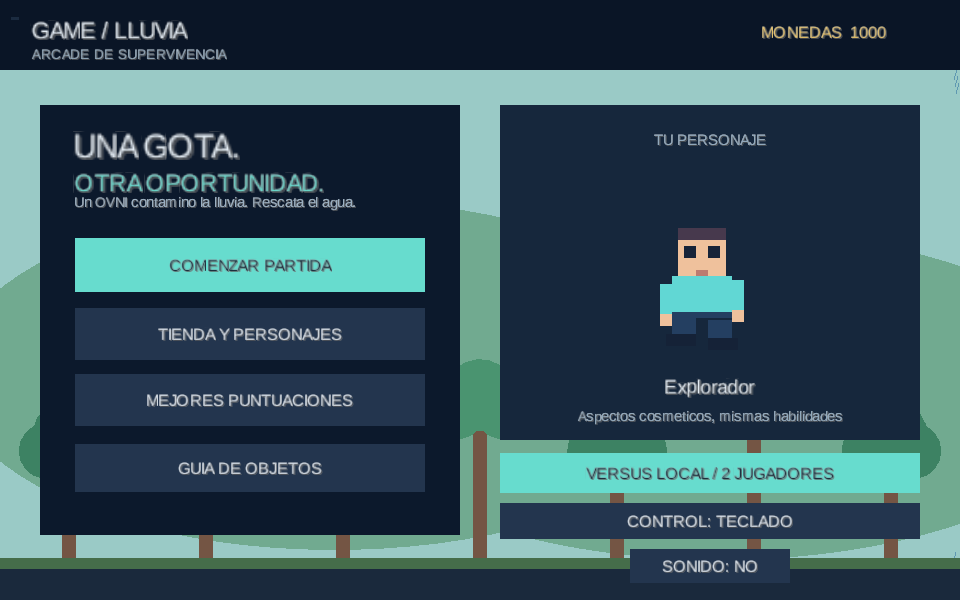

# Guardián de la Lluvia

Proyecto de Programación Avanzada en Java y LibGDX, basado en el juego entregado por el profesor.

**Integrantes:** Matías Santelices S., Rodrigo Escudero y Ariel Fuenzalida.



## Descargar y jugar

En GitHub, selecciona la rama **mav/armas-biomas-jefe**, pulsa **Code > Download ZIP** y descomprime el archivo. Necesitas **JDK 17** e Internet en la primera ejecución. El proyecto incluye Gradle Wrapper.

### Eclipse

1. Abre **File > Import > Gradle > Existing Gradle Project**. Si falta la opción, instala Buildship.
2. Selecciona la carpeta que contiene `settings.gradle`. Usa Gradle Wrapper y selecciona JDK 17 para Gradle.
3. Abre **Window > Show View > Other > Gradle > Gradle Tasks** y ejecuta **lwjgl3 > application > run**.

### PowerShell

Desde la carpeta que contiene `gradlew.bat`:

```powershell
.\gradlew.bat -Pandroid=false :lwjgl3:run
```

Para ejecutar las pruebas, usa `.\gradlew.bat -Pandroid=false :core:test`. En Linux o macOS, usa `./gradlew` con las mismas opciones.

### Android Studio

Abre la carpeta raíz, selecciona JDK 17 para Gradle y configura SDK Platform 35. Después de sincronizar, puedes compilar con `.\gradlew.bat -Pandroid=true :android:assembleDebug`.

## Controles

| Acción | Campaña | Versus |
| --- | --- | --- |
| Mover | A/D, flechas o toque | J1 A/D · J2 flechas |
| Disparar | Espacio o clic/toque en el campo | J1 W · J2 flecha arriba |
| Pausa | P o Esc | P o Esc |

En campaña, **T** o el botón del HUD cambian entre teclado y control táctil en plena partida.

## Documentos

- [Informe del proyecto (PDF)](01-Informe-GameLluvia.pdf), con los diagramas UML.
- [Manual de usuario (PDF)](02-Manual-de-Usuario-GameLluvia.pdf).
