# Reporte ejecutivo — GameLluvia: Guardián de la lluvia

**Integrantes:** Matías Santelices S., Rodrigo Escudero y Ariel Fuenzalida.
**Asignatura:** Programación Avanzada. **Entrega:** 23 de octubre de 2026.

Este reporte corresponde a la campaña de 30 niveles y a la preparación final del proyecto. Las evidencias enlazan archivos y líneas de la copia documentada; si se cambia el código, se deben revisar las referencias. El historial de entrega y las pruebas se documentan en GM-10 y VALIDACION.md.


## GM-1. Perspectiva del jugador

### Aplicación

El jugador es el Guardián de la Lluvia: recoge agua en un entorno afectado por contaminantes y acumula una reserva con la que se enfrenta a un OVNI. La recolección tiene dos propósitos: avanzar por puntuación y obtener munición para el combate final. Se pierde al quedarse sin vidas y se gana al derrotar al jefe.

La campaña comprende llanura (niveles 1–10), hielo (11–20) y desierto de Atacama (21–30). El agua normal suma 10 puntos y una carga. Cada 100 puntos permite avanzar; los peligros pueden hacer retroceder. A partir de 3000 puntos comienza el ascenso de tres segundos y después la fase del jefe. **No existe un nivel numérico 31 jugable**: el jefe es otra fase de la partida y el nivel mostrado permanece en 30.

Noob tiene 5 vidas, Pro 3 y Hacker 1; también cambia el ritmo de caída. Después de cuatro segundos sin recoger agua comienza una reducción progresiva de velocidad, hasta un 60 %. Agua normal, doble y oasis restablecen la hidratación. No se exige agua durante las rondas de monedas.

| Elemento | Efecto base |
|---|---|
| Agua / agua doble / oasis | +10/+20/+30 puntos y +1/+2/+3 cargas; hidratan |
| Café / fruta | Velocidad ×1,5 durante 7 segundos |
| Termo | Protección frente a nieve/hielo durante 8 segundos; elimina esos efectos activos |
| Monedas dobles / puntos dobles | Multiplicador correspondiente durante 8 segundos |
| Sangre / tinta | −20 / −50 puntos |
| Veneno / nieve | −10 / −20 puntos y velocidad a la mitad durante 5 / 4 segundos |
| Hielo / excremento de pájaro | Inmovilización durante 1,5 segundos; hielo también resta 30 puntos |
| Ácido / fuego / cactus | −1 vida y −30/−40/−25 puntos si el golpe es aceptado |
| Bolsa rota | Pierde hasta 5 monedas de la partida y bloquea su recolección durante 4 segundos |

Los puntos nunca quedan negativos. El multiplicador de puntos no multiplica la munición. Tras un daño aceptado hay 1,2 segundos de protección contra nuevos golpes que quitan vida.

El menú ofrece comenzar, tienda, mejores puntuaciones, guía de objetos y versus. Hay 29 aspectos: uno inicial, 15 comprables, nueve por niveles, tres por victoria de campaña y un alien oculto. Son cosméticos. La campaña entrega además una bolsa de 250/400/550 monedas al ganar en Noob/Pro/Hacker. Los récords son locales por dificultad.

Al llegar por primera vez a cada hito 5, 10, 15, 20, 25 y 30 se activa una ronda de monedas de ocho segundos; descender y regresar no permite repetir el mismo hito. Un botón discreto arriba a la izquierda del menú abre otro secreto: combate directo en Pro, con 40 cargas iniciales. Solo desbloquea al alien si se gana y no modifica dinero, ranking ni niveles guardados.

| Acción | Campaña | Versus local |
|---|---|---|
| Movimiento | A/D o flechas izquierda/derecha; ratón/táctil seleccionable | J1 A/D; J2 izquierda/derecha |
| Disparo al jefe | Espacio o clic en el área de juego | J1 W; J2 arriba |
| Pausa | P, Escape o botón | P, Escape o botón |
| Confirmación | Enter o botones | Enter o botones |
| Sonido | M o botón | M o botón |

Versus usa un teclado y pantalla dividida: gana quien sobrevive al rival o vence primero al OVNI, con empate si ambos pierden a la vez o ambos ganan. No altera el perfil de campaña. El control táctil existe, pero no equivale a una validación en Android.

### Evidencia
- [GameLluvia.java, línea 209](../core/src/main/java/puppy/code/GameLluvia.java#L209) (`private void menu()`)
- [Partida.java, línea 36](../core/src/main/java/puppy/code/Partida.java#L36) (`public void actualizar(float delta)`)
- [Personaje.java, línea 78](../core/src/main/java/puppy/code/Personaje.java#L78) (`public void atrapar(`)
- [Dificultad.java, línea 4](../core/src/main/java/puppy/code/Dificultad.java#L4) (`NOOB(`)
- [Aspecto.java, línea 4](../core/src/main/java/puppy/code/Aspecto.java#L4) (`EXPLORADOR(`)
- [PartidaVersus.java, línea 14](../core/src/main/java/puppy/code/PartidaVersus.java#L14) (`public int getGanador()`)


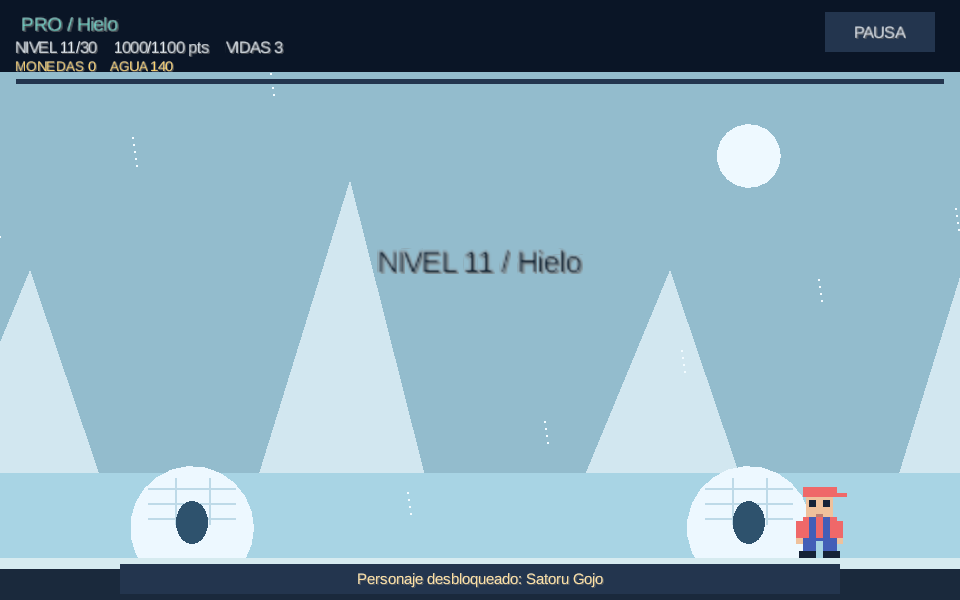
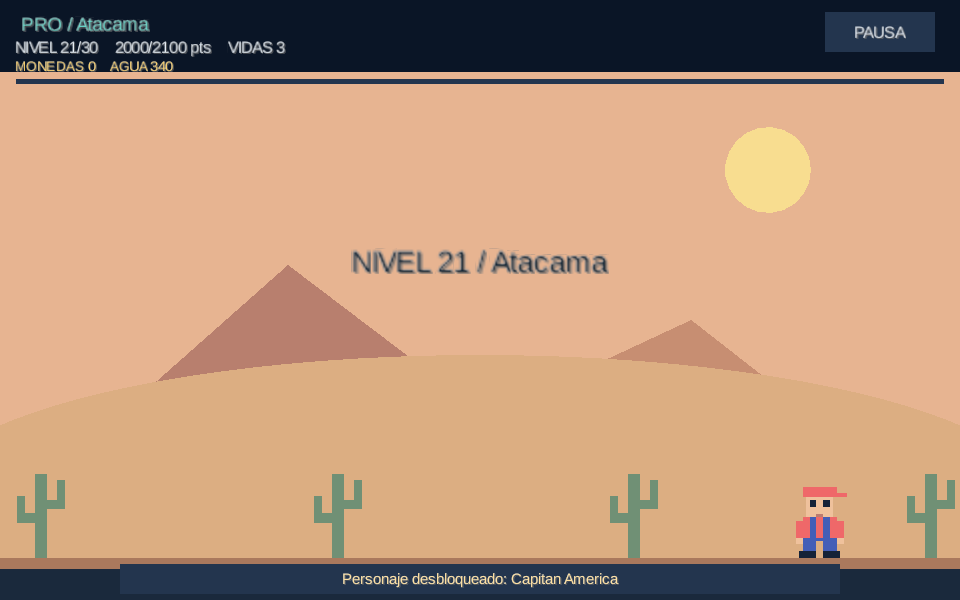
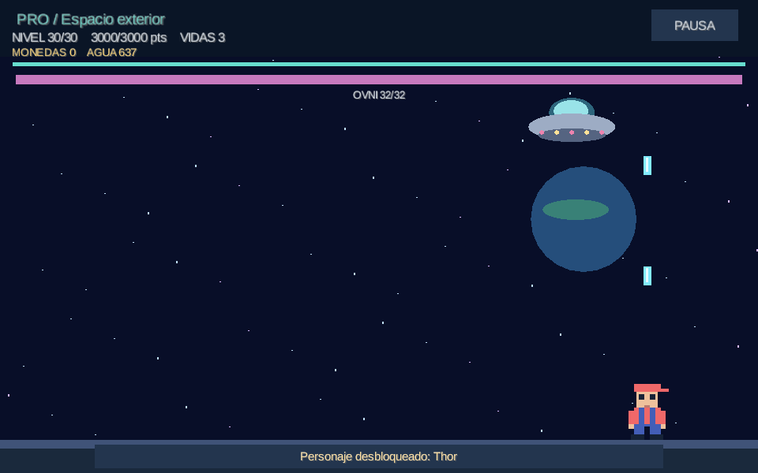


## GM-2. Análisis desde ingeniería de software

### Aplicación y comparación con la base

La base entregada por el profesor, GameLluvia2024, es un proyecto LibGDX con módulos `core` y `lwjgl3`. Sus clases principales son `GameLluvia`, `Tarro` y `Lluvia`: una cubeta recibe gotas buenas o dañinas. La comparación se realizó contra la copia original conservada, no contra el README antiguo.

| Base observada | Modificación y motivo |
|---|---|
| `Lluvia` mantiene dos arrays paralelos para rectángulos y tipos. | Una lista de objetos `Gota` reúne posición y comportamiento, y permite procesarlos polimórficamente. |
| `actualizarMovimiento()` borra por índice mientras avanza hacia delante. | Recorrido inverso para no saltar el elemento que ocupa el índice eliminado. |
| `Tarro.dibujar()` descuenta un contador de 50 cuadros para terminar el daño. | Temporizador en segundos dentro de `Personaje.actualizar()`; el dibujo no decide cuándo termina la protección. |
| La base no contiene estado final por agotamiento de vidas y puede seguir descontándolas. | Daño acotado y fases de derrota/victoria, reinicio y pausa. |
| Las texturas de gotas y el sonido de daño no se liberan en sus destructores. | Recursos de audio liberados en `GameLluvia.dispose()` y gráficos en `VistaJuego.dispose()`. |
| Cámara fija de 800×480, sin gestión propia del redimensionado. | Mundo de 960×600 con `FitViewport`, coordenadas convertidas para la entrada y bandas al cambiar proporción. |
| Control táctil comentado dentro de `Tarro`. | Interfaz con estrategias de teclado y táctil; selección al iniciar. |
| Sin campaña, perfil ni tienda. | `Partida`, `PerfilJugador`, configuración de zonas/dificultad, jefe, catálogo y versus. |

Las modificaciones separan reglas, dibujo, entrada y persistencia, manteniendo una solución universitaria directa. `GameLluvia` conserva coordinación, estados y parte de la presentación; no afirmamos separación completa mediante MVC. El dominio todavía utiliza tipos de LibGDX como `Rectangle`.

### Evidencia
- [Lluvia.java, línea 29](../core/src/main/java/puppy/code/Lluvia.java#L29) (`public void mover(`)
- [Personaje.java, línea 69](../core/src/main/java/puppy/code/Personaje.java#L69) (`public boolean recibirDanio()`)
- [GameLluvia.java, línea 424](../core/src/main/java/puppy/code/GameLluvia.java#L424) (`@Override public void dispose()`)
- [VistaJuego.java, línea 110](../core/src/main/java/puppy/code/VistaJuego.java#L110) (`public void dispose()`)
- [Partida.java, línea 7](../core/src/main/java/puppy/code/Partida.java#L7) (`public enum Fase`)

## GM-3. Diseño UML del dominio y relación con LibGDX

### Problema
La ampliación agrega campaña, perfil, variantes de objetos y un jefe. Sin un mapa de responsabilidades sería difícil identificar qué clase contiene cada regla.

### Contexto
El módulo `core` comparte el juego entre launchers. `GameLluvia` extiende `ApplicationAdapter`; `VistaJuego` utiliza los recursos gráficos y las reglas utilizan rectángulos para colisionar.

### Solución y aplicación
El diagrama muestra las relaciones principales: una partida contiene personaje y lluvia; el versus contiene dos partidas; el perfil utiliza preferencias; los controles implementan una interfaz. La línea discontinua sin triángulo representa dependencia; con triángulo hacia una interfaz representa implementación. La herencia de clases usa línea continua y triángulo. Los ayudantes gráficos y la clase heredada `GotaMala` se omiten para que la vista general sea legible; no es una enumeración exhaustiva de todos los campos.

### Evidencia
- [GameLluvia.java, línea 14](../core/src/main/java/puppy/code/GameLluvia.java#L14) (`extends ApplicationAdapter`)
- [Partida.java, línea 8](../core/src/main/java/puppy/code/Partida.java#L8) (`private final Personaje`)
- [PartidaVersus.java, línea 4](../core/src/main/java/puppy/code/PartidaVersus.java#L4) (`private final Partida`)
- [VistaJuego.java, línea 14](../core/src/main/java/puppy/code/VistaJuego.java#L14) (`private final SpriteBatch`)
- [PerfilJugador.java, línea 9](../core/src/main/java/puppy/code/PerfilJugador.java#L9) (`private final Preferences`)

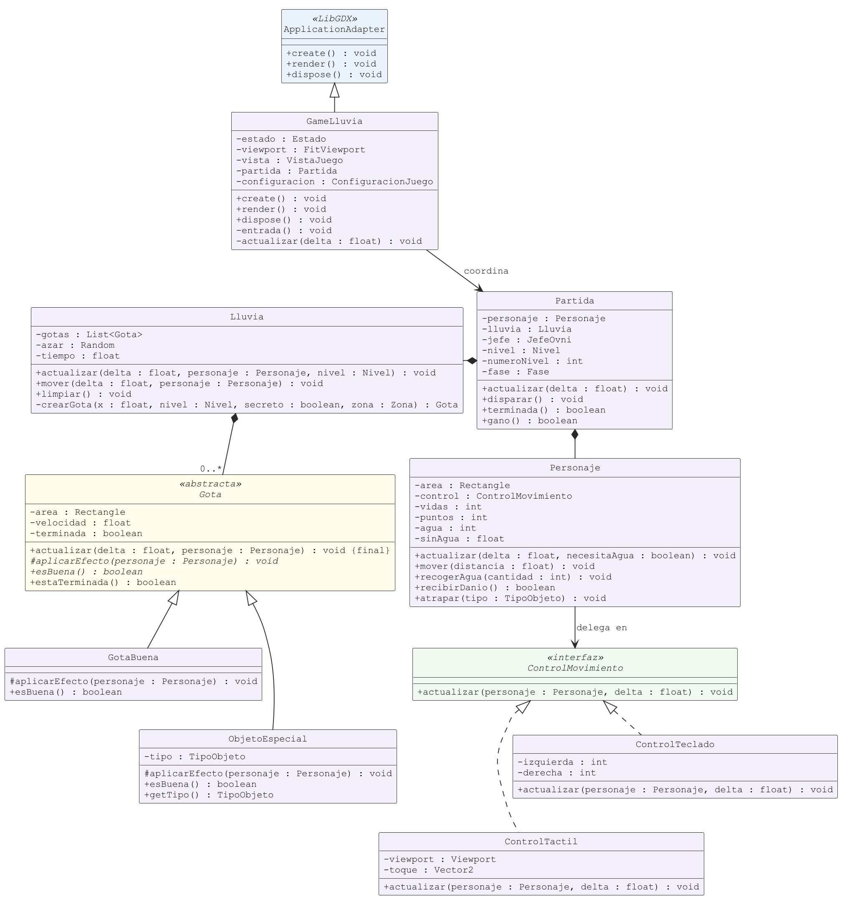

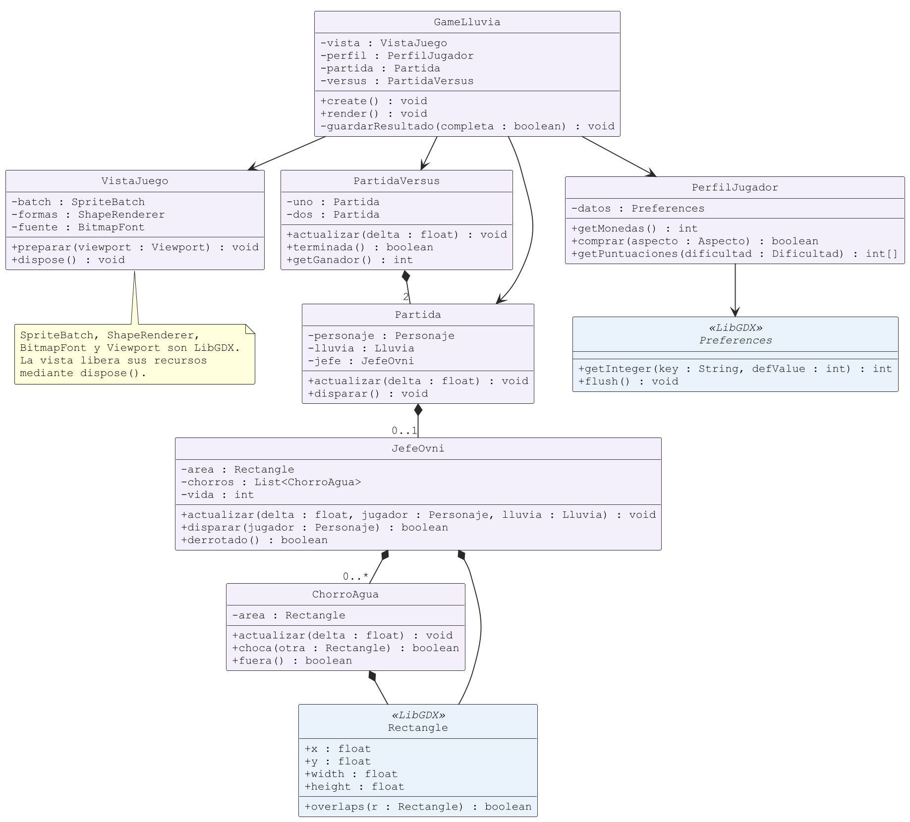

Fuente editable: [PlantUML](uml/01-dominio.puml).

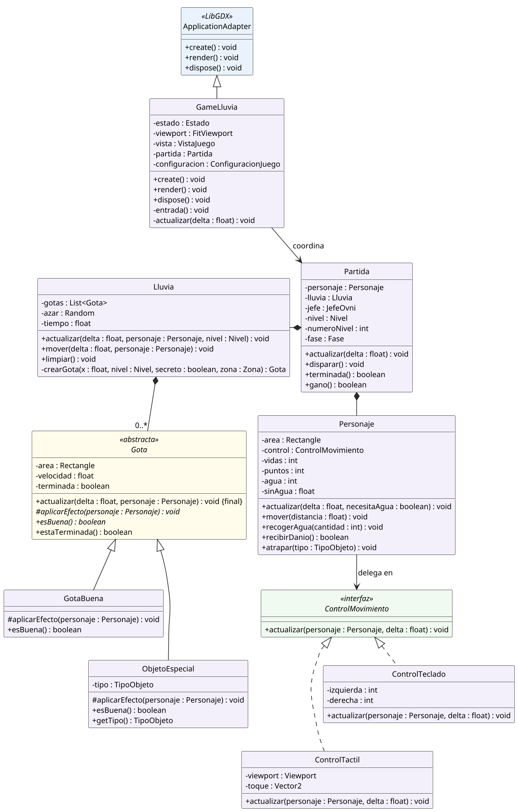


## GM-4. Clase abstracta e interfaz utilizadas

### Aplicación
`Gota` es abstracta. Sus hijas `GotaBuena` y `ObjetoEspecial` son creadas por `Lluvia.crearGota()` y usadas como `Gota` en `Lluvia.mover()`. La primera recoge agua; la segunda aplica un `TipoObjeto`. `GotaMala` sigue en el código como clase de la versión anterior, pero no se utiliza como evidencia principal porque la fábrica actual no la genera.

`ControlMovimiento` tiene dos implementaciones: `ControlTeclado` y `ControlTactil`. `GameLluvia.iniciar()` elige una y `Partida` la entrega al personaje. `Personaje.actualizar()` la invoca en ejecución. El modo ratón permite ejercitar la estrategia táctil en escritorio.

### Evidencia
- [Gota.java, línea 5](../core/src/main/java/puppy/code/Gota.java#L5) (`public abstract class`)
- [GotaBuena.java, línea 3](../core/src/main/java/puppy/code/GotaBuena.java#L3) (`extends Gota`)
- [ObjetoEspecial.java, línea 3](../core/src/main/java/puppy/code/ObjetoEspecial.java#L3) (`extends Gota`)
- [Lluvia.java, línea 40](../core/src/main/java/puppy/code/Lluvia.java#L40) (`private Gota crearGota(`)
- [ControlMovimiento.java, línea 3](../core/src/main/java/puppy/code/ControlMovimiento.java#L3) (`public interface`)
- [ControlTeclado.java, línea 6](../core/src/main/java/puppy/code/ControlTeclado.java#L6) (`implements ControlMovimiento`)
- [ControlTactil.java, línea 7](../core/src/main/java/puppy/code/ControlTactil.java#L7) (`implements ControlMovimiento`)
- [Personaje.java, línea 41](../core/src/main/java/puppy/code/Personaje.java#L41) (`control.actualizar(this, delta)`)
- [GameLluvia.java, línea 50](../core/src/main/java/puppy/code/GameLluvia.java#L50) (`private void iniciar()`)

Diseño: diagramas de GM-3, GM-7 y GM-8. No basta declarar las clases: las llamadas anteriores demuestran su uso.

## GM-5. Encapsulamiento, GRASP y SOLID

### Aplicación

| Principio | Aplicación concreta y límite |
|---|---|
| Encapsulamiento | Vidas, puntos, monedas y área de `Personaje` son privados. `recibirDanio()` rechaza golpes durante protección y con cero vidas. `quitarPuntos()` evita negativos. |
| Experto en información, GRASP | `Personaje` aplica efectos porque conoce sus recursos; `PerfilJugador` decide una compra porque conoce saldo y propiedad del aspecto. |
| Alta cohesión, GRASP | `Lluvia` administra objetos caídos; `JefeOvni` administra ataques y proyectiles; los ayudantes de dibujo representan elementos. |
| Bajo acoplamiento, GRASP | Los controles comparten un contrato y las reglas no cargan sonidos ni texturas. Existe dependencia de LibGDX en colisiones y entrada. |
| Responsabilidad única, SOLID | Se separan movimiento, perfil y reglas de campaña. Aplicación parcial: `GameLluvia` todavía coordina y presenta varias pantallas. |
| Abierto/cerrado, SOLID | Puede agregarse otra estrategia sin cambiar cómo `Personaje` invoca el contrato. No se afirma cumplimiento total: nuevos efectos pueden requerir modificar un `switch`. |
| Sustitución de Liskov, SOLID | Las gotas utilizadas respetan el contrato de actualización y finalización; sus efectos varían mediante el método abstracto. |
| Segregación de interfaces, SOLID | `ControlMovimiento` exige solo `actualizar`; no impone audio o dibujo a los controles. |
| Inversión de dependencias, SOLID | `Personaje` recibe `ControlMovimiento` en su constructor y depende de esa abstracción. La composición concreta se resuelve fuera de él. |

`Lluvia.getGotas()` devuelve una vista no modificable de la lista; impide agregar o quitar elementos desde la vista, pero no convierte los objetos contenidos en inmutables. `Nivel` sí tiene sus datos privados finales y no ofrece setters.

### Evidencia
- [Personaje.java, línea 10](../core/src/main/java/puppy/code/Personaje.java#L10) (`private final ControlMovimiento`)
- [Personaje.java, línea 69](../core/src/main/java/puppy/code/Personaje.java#L69) (`public boolean recibirDanio()`)
- [PerfilJugador.java, línea 27](../core/src/main/java/puppy/code/PerfilJugador.java#L27) (`public boolean comprar(`)
- [Lluvia.java, línea 10](../core/src/main/java/puppy/code/Lluvia.java#L10) (`Collections.unmodifiableList`)
- [Nivel.java, línea 4](../core/src/main/java/puppy/code/Nivel.java#L4) (`private final String`)

## GM-6. Singleton

### Problema
La configuración y el perfil deben consultarse desde diferentes estados sin crear copias con valores divergentes.

### Contexto
La aplicación inicializa LibGDX antes de acceder a las preferencias; el flujo ordinario se ejecuta en el hilo principal.

### Solución y aplicación
`ConfiguracionJuego` tiene constructor privado, instancia estática privada y acceso mediante `getInstancia()`. `GameLluvia.create()` obtiene la instancia. El constructor utiliza `Gdx.app.getPreferences()` y crea el perfil asociado. No es una implementación sincronizada para uso concurrente ni un gestor global de todos los recursos.

### Evidencia
- [ConfiguracionJuego.java, línea 7](../core/src/main/java/puppy/code/ConfiguracionJuego.java#L7) (`private static ConfiguracionJuego`)
- [ConfiguracionJuego.java, línea 13](../core/src/main/java/puppy/code/ConfiguracionJuego.java#L13) (`private ConfiguracionJuego()`)
- [ConfiguracionJuego.java, línea 19](../core/src/main/java/puppy/code/ConfiguracionJuego.java#L19) (`public static ConfiguracionJuego getInstancia()`)
- [GameLluvia.java, línea 37](../core/src/main/java/puppy/code/GameLluvia.java#L37) (`configuracion = ConfiguracionJuego.getInstancia()`)

### UML
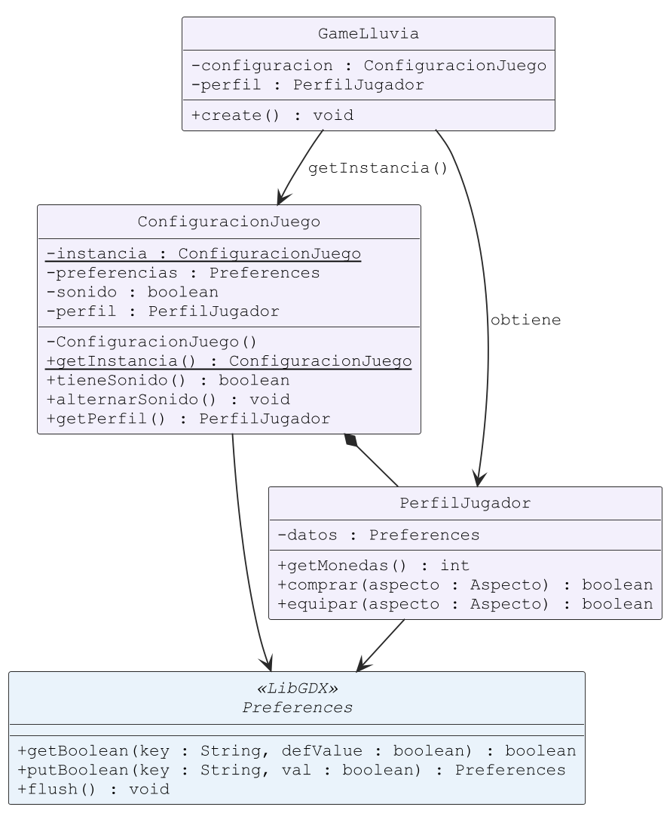

Fuente editable: [PlantUML](uml/02-singleton.puml).

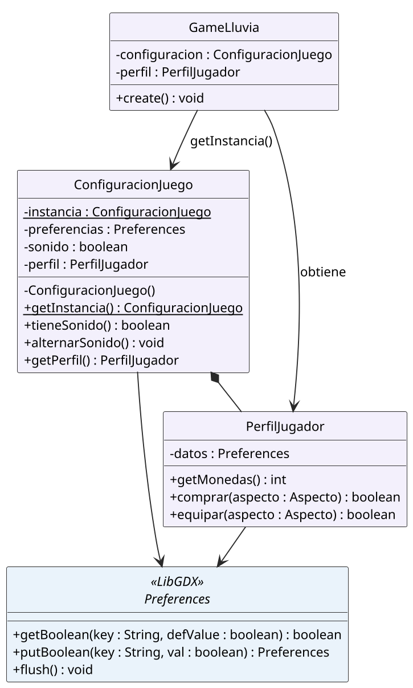


## GM-7. Strategy

### Problema
El movimiento depende del dispositivo de entrada, pero el personaje debe conservar las mismas reglas de límites, velocidad y efectos.

### Contexto
Se permite teclado o ratón/táctil; versus asigna teclas distintas a cada jugador.

### Solución y aplicación
`Personaje` es el contexto; `ControlMovimiento` es la estrategia; `ControlTeclado` y `ControlTactil` son las implementaciones. Se inyecta el control al construir la partida y el personaje delega en él en cada actualización. El teclado calcula una dirección y el táctil convierte coordenadas mediante `Viewport.unproject()`.

### Evidencia
- [ControlMovimiento.java, línea 4](../core/src/main/java/puppy/code/ControlMovimiento.java#L4) (`void actualizar(`)
- [Personaje.java, línea 41](../core/src/main/java/puppy/code/Personaje.java#L41) (`control.actualizar(this, delta)`)
- [ControlTeclado.java, línea 11](../core/src/main/java/puppy/code/ControlTeclado.java#L11) (`public void actualizar(`)
- [ControlTactil.java, línea 16](../core/src/main/java/puppy/code/ControlTactil.java#L16) (`viewport.unproject`)
- [GameLluvia.java, línea 50](../core/src/main/java/puppy/code/GameLluvia.java#L50) (`private void iniciar()`)

### UML
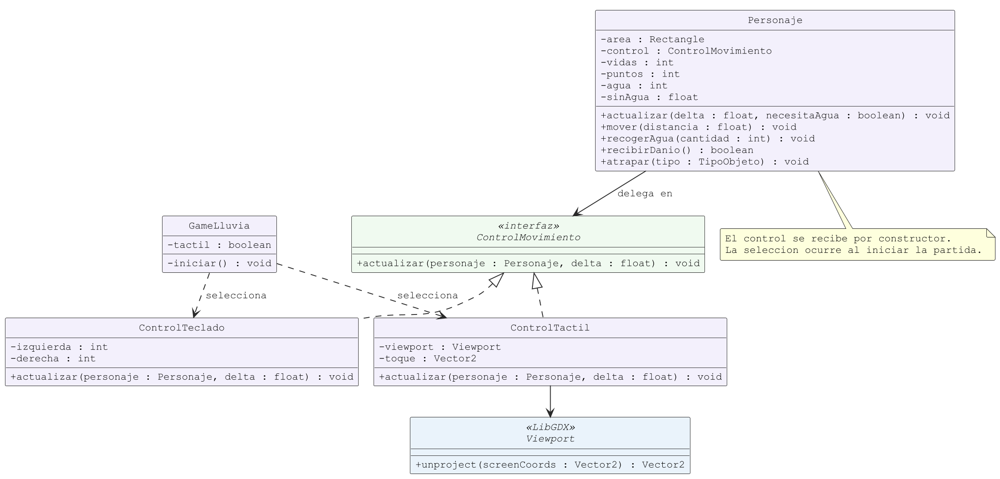

Fuente editable: [PlantUML](uml/03-strategy.puml).

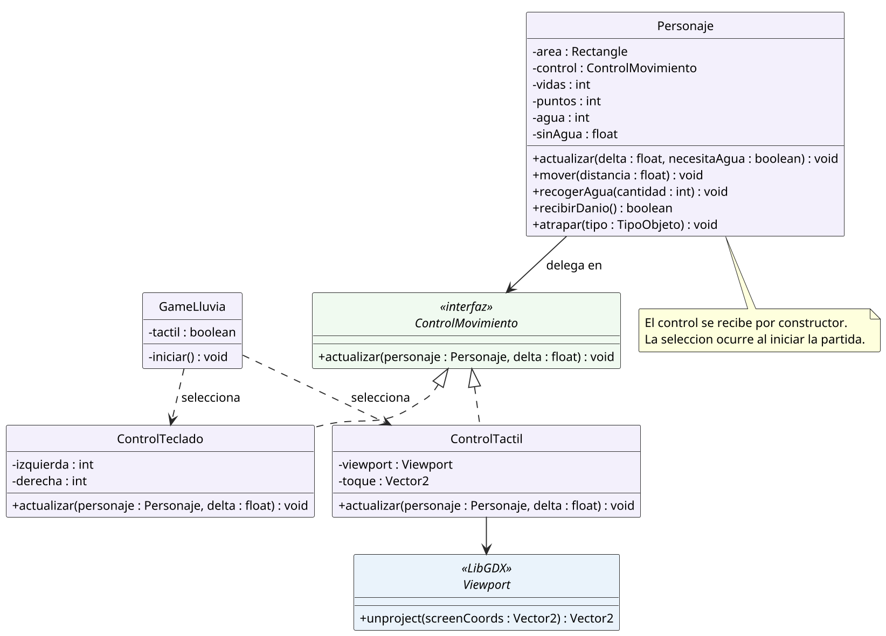


## GM-8. Template Method

### Problema
Los objetos comparten caída y colisión, pero tienen distintos efectos al ser recogidos.

### Contexto
`Lluvia` recorre una colección de `Gota` que contiene agua y objetos especiales.

### Solución y aplicación
`Gota.actualizar()` es `final`: rechaza un objeto terminado, mueve su área, verifica salida y colisión, ejecuta `aplicarEfecto()` y marca la finalización. `aplicarEfecto()` es abstracto. `GotaBuena` recoge agua y `ObjetoEspecial` delega el efecto al personaje. La plantilla fija el algoritmo mientras sus hijas implementan el paso variable.

### Evidencia
- [Gota.java, línea 16](../core/src/main/java/puppy/code/Gota.java#L16) (`public final void actualizar(`)
- [Gota.java, línea 27](../core/src/main/java/puppy/code/Gota.java#L27) (`protected abstract void aplicarEfecto(`)
- [GotaBuena.java, línea 5](../core/src/main/java/puppy/code/GotaBuena.java#L5) (`aplicarEfecto(`)
- [ObjetoEspecial.java, línea 9](../core/src/main/java/puppy/code/ObjetoEspecial.java#L9) (`aplicarEfecto(`)
- [Lluvia.java, línea 34](../core/src/main/java/puppy/code/Lluvia.java#L34) (`gota.actualizar(delta, personaje)`)

### UML
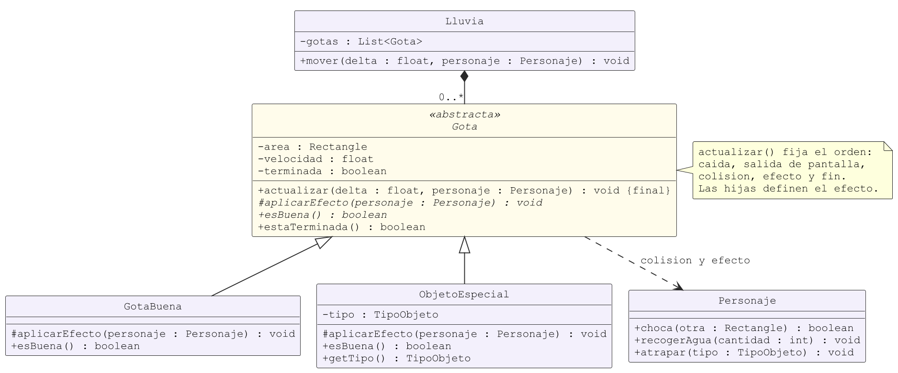

Fuente editable: [PlantUML](uml/04-template-method.puml).

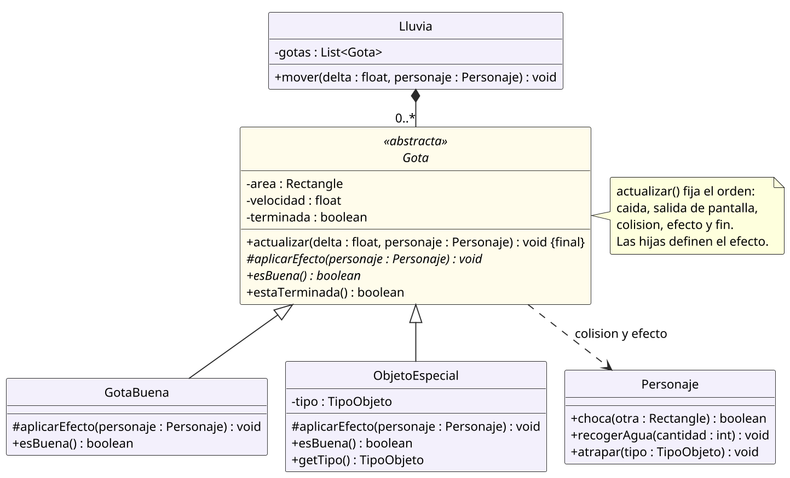


## GM-9. Builder

### Problema
Un constructor con varios números facilitaría confundir objetivo, velocidad, intervalo y probabilidad.

### Contexto
Cada dificultad construye configuraciones para 30 niveles; se necesitan valores válidos e inmutabilidad posterior.

### Solución y aplicación
`Nivel.Builder` ofrece métodos encadenables con nombres y valores predeterminados. `construir()` comprueba nombre, objetivo positivo, velocidad e intervalo positivos y finitos, y probabilidad finita entre 0 y 1. Crea un `Nivel` con campos privados finales. El cliente real es `Dificultad.crearNivel()`. No se incorpora un Director porque esta construcción no lo necesita.

### Evidencia
- [Nivel.java, línea 23](../core/src/main/java/puppy/code/Nivel.java#L23) (`public static class Builder`)
- [Nivel.java, línea 34](../core/src/main/java/puppy/code/Nivel.java#L34) (`public Nivel construir()`)
- [Nivel.java, línea 10](../core/src/main/java/puppy/code/Nivel.java#L10) (`private Nivel(Builder b)`)
- [Dificultad.java, línea 16](../core/src/main/java/puppy/code/Dificultad.java#L16) (`public Nivel crearNivel(`)

### UML
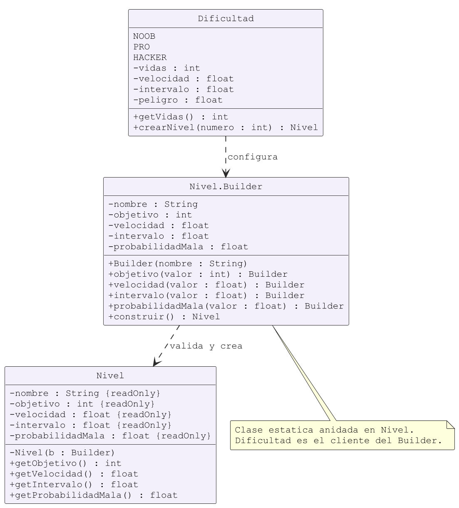

Fuente editable: [PlantUML](uml/05-builder.puml).

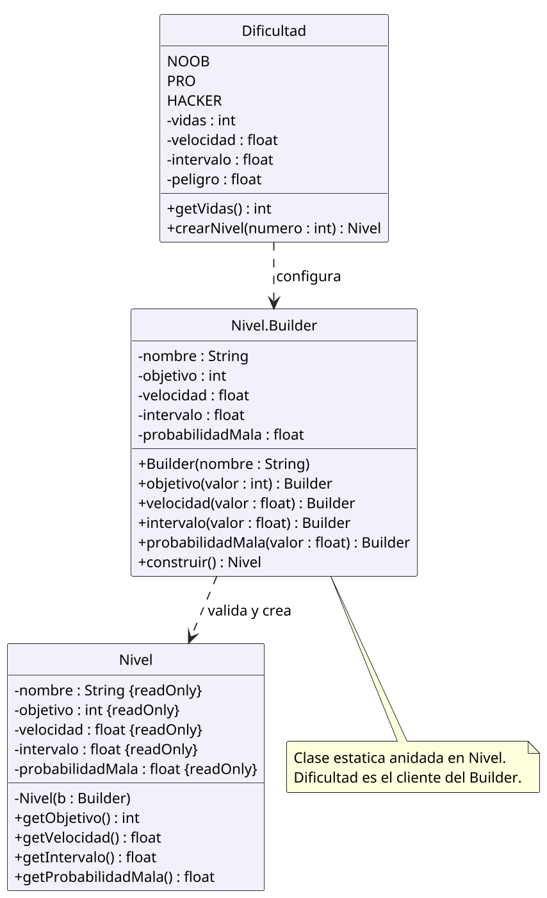


## GM-10. GitHub e historial de evolución

### Aplicación

El repositorio conserva seis commits de avances reales. Se verificó por consulta al remoto que la rama `entrega-final` apunta a `dd95078a1b2b7f9219c420c02deb36337b5b77ef`, que contiene el historial siguiente:

| Commit | Avance registrado |
|---|---|
| eccd0ff | Primera versión jugable, patrones y pruebas |
| 86acf62 | Tienda, personajes, dificultades y efectos |
| d52952e | Campaña de 30 niveles, jefe OVNI y versus |
| af75f64 | Nuevas skins, vidas por dificultad y desafío alien |
| cbd0d0f | JAR ejecutable con dependencias y prueba de assets |
| dd95078 | Reporte, UML, README y guías de entrega |

### Evidencia

- [Rama de entrega publicada](https://github.com/maverick1006/Proyecto-Game-LLuvia-/tree/entrega-final).
- [Historial de la rama](https://github.com/maverick1006/Proyecto-Game-LLuvia-/commits/entrega-final/).
- [Sexto commit verificado](https://github.com/maverick1006/Proyecto-Game-LLuvia-/commit/dd95078a1b2b7f9219c420c02deb36337b5b77ef).

La comprobación se realizó el 23 de octubre de 2026. Se distinguen los commits publicados de cualquier ajuste documental posterior. Los nombres de los tres integrantes en la portada no se utilizan para atribuirles commits que Git no registra a su nombre.

```bash
git log --oneline --reverse
git rev-list --count dd95078
git ls-remote --heads origin
```

## Validación y alcance de la entrega

Los resultados reproducidos y las limitaciones están en [VALIDACION.md](VALIDACION.md). El APK Android se compiló con JDK 17 y SDK 35; la ejecución en teléfono sigue pendiente. El paquete Eclipse se importó en un workspace nuevo de Eclipse 2024-06 y abrió el menú y una partida. Se exportó mediante Archive File del IDE y se comparó su contenido con el paquete portátil. Consultar [ENTREGA_ECLIPSE.md](ENTREGA_ECLIPSE.md) y [ANDROID_STUDIO.md](ANDROID_STUDIO.md).

## Fuentes

- Pauta GM-1 a GM-10 y reglas del reporte compartidas por el equipo.
- Código base GameLluvia2024 entregado por el profesor y código actual del repositorio.
- [LibGDX: importar y ejecutar](https://libgdx.com/wiki/start/import-and-running).
- [Repositorio cars, referencia de organización del README](https://github.com/Schiz0idCat/cars/blob/main/README.md).
