# Reporte de correcciones — GameLluvia: Guardián de la lluvia

**Integrantes:** Matías Santelices S., Rodrigo Escudero y Ariel Fuenzalida.

**Proyecto:** Programación Avanzada · Java y LibGDX.

**Revisión:** 10 de noviembre de 2026.

## GM-1. Perspectiva del jugador

### Historia: rescatar la lluvia

Una nave altera la lluvia sobre Chile. En la llanura aún quedan gotas de agua limpia, pero junto a ellas caen gotas contaminadas que obligan al guardián a moverse con cuidado. El menú muestra el tarro, la gota azul y la gota oscura del juego base: son el equipo y las señales con que empezó el rescate. Durante la partida, los escenarios y las variantes de gotas se dibujan con LibGDX.

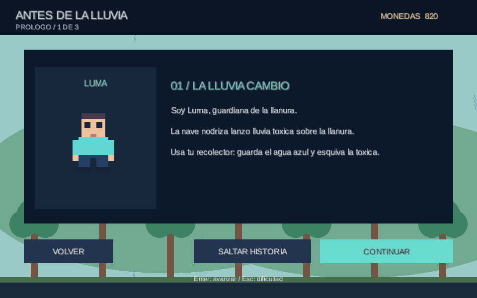

Luma explica que la nave nodriza del Jefe OVNI está contaminando la lluvia. En los sprites originales, `bucket.png` representa el recolector del protagonista, `drop.png` el agua pura y `dropBad.png` la lluvia tóxica. Esos archivos se conservan como referencia del juego base. En la partida, `Personaje` recoge el agua de `GotaBuena` y esquiva el ácido de `GotaMala`. La misión pasa de la llanura al hielo del sur y al oasis de Atacama. Al completar la campaña, el rayo de la nave inicia el Ascenso. En el espacio, cada carga de agua alimenta un `ChorroAgua` con el que podemos derribar al Jefe OVNI. El aspecto Alien es un recuerdo del encuentro secreto y se desbloquea al vencer al OVNI de ese desafío.

El prólogo de Luma avanza con Enter o Continuar. Se puede saltar o volver a elegir dificultad. Durante la lectura, el estado es `PROLOGO` y la partida todavía no se actualiza.

La contaminación cambia con el paisaje. En el sur, el agua se congela: la nieve ralentiza, el hielo puede inmovilizar y el termo ayuda a atravesar la zona. En Atacama, la sequía y el calor vuelven escasa el agua; una gota de oasis repone cargas para el combate. Las alertas de nivel dan una pista distinta en cada escenario. Al llegar a 3000 puntos, el OVNI activa su rayo y se lleva al guardián. En órbita, el agua que venía recogiendo pasa de ser un recurso de supervivencia a ser la munición del chorro. El encuentro oculto permite desbloquear el aspecto Alien: es una recompensa cosmética y no afecta al progreso de la campaña.

- **Objetivo:** superar 30 niveles, llegar al espacio y vencer al OVNI.
- **Movimiento:** A/D o flechas; con el control táctil se mantiene pulsado sobre el mundo.
- **Cambio en plena partida:** T o el botón del HUD, en campaña y desafío oculto. Versus conserva un teclado compartido.
- **Disparo:** Espacio o clic durante el jefe; consume una carga de agua. P o Escape pausa y M alterna el sonido.
- **Dificultad:** Noob tiene cinco vidas, Pro tres y Hacker una; también varían el intervalo, la velocidad y los peligros.
- **Versus:** J1 se mueve con A/D y dispara con W. J2 usa flechas y dispara con Arriba.

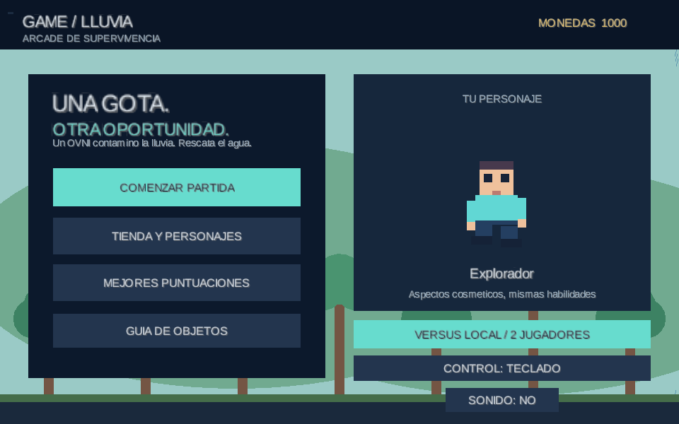
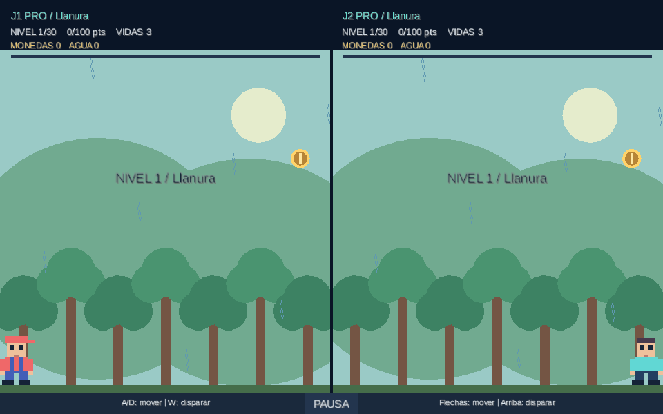
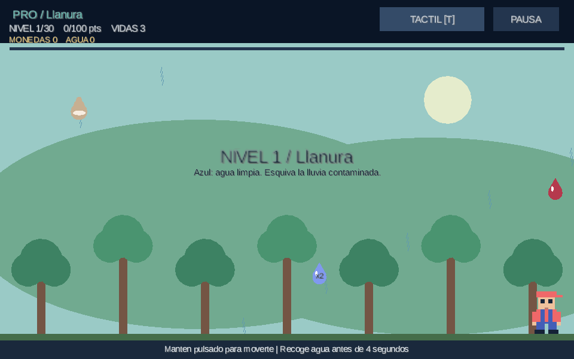
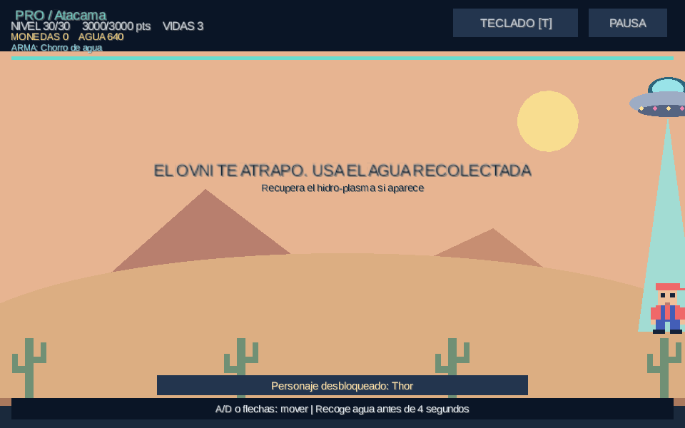

## GM-2. Qué se cambió y por qué

La base del profesor tenía tres clases de juego: `GameLluvia`, `Tarro` y `Lluvia`. El ciclo básico ya funcionaba: moverse, recoger gotas, sumar puntos y perder vidas. El problema aparecía al agregar campañas, estados y otro tipo de control: la entrada, la simulación y el dibujo estaban acoplados al ciclo gráfico de LibGDX.

| Antes | Cómo se hizo el cambio | Por qué sirve |
|---|---|---|
| `GameLluvia.render()` actualizaba cámara, marcadores, tarro y lluvia desde el mismo bloque de dibujo. | Las reglas de campaña se concentran en `Partida.actualizar(float)`. Ahí se decide el avance por puntos, el cambio de zona, el ascenso y la aparición del jefe. `GameLluvia` coordina pantallas, entrada y sonido; llama a la simulación antes de dibujar. | Se puede probar una partida con un delta y una semilla conocidos, sin crear una ventana. `CampanaTest` comprueba progresión, zonas y combate. |
| La vista del tarro estaba en `Tarro.dibujar()` y la lluvia en `Lluvia.actualizarDibujoLluvia()`. | `VistaJuego` concentra el lote de sprites, las formas y los textos. Delega personajes a `DibujoPersonaje.dibujar()`, escenarios a `DibujoEscenario.fondo()` y objetos a `DibujoObjetos.dibujar()`. También libera las texturas del menú en `dispose()`. | Cambiar el dibujo de una gota o la paleta de Atacama no exige cambiar las colisiones ni las reglas. Se separa presentación de simulación. |
| La lluvia guardaba un arreglo de posiciones y otro de números de tipo. Al borrar una gota había que sincronizar ambos índices. | `Lluvia` administra una sola `List<Gota>`. Cada elemento conserva su geometría y decide cómo cae, cómo choca y qué efecto aplica. `mover()` recorre la colección hacia atrás y elimina los elementos terminados. | Los datos y su comportamiento quedan juntos. `ReglasJuegoTest` comprueba que no se salten gotas al borrar, que no se recojan dos veces y que cada tipo tenga la colisión que corresponde. |
| `Tarro` leía el teclado dentro de su movimiento, y la lluvia consultaba su rectángulo. | `Personaje` conserva su área privada y expone operaciones de movimiento, colisión y efectos. Lee la entrada de forma indirecta: delega en `ControlMovimiento`. El control se puede sustituir en una partida activa. | La lógica se prueba sin un teclado ni una pantalla táctil. El motor del juego depende de una interfaz pequeña y ambas entradas reutilizan los mismos límites y efectos. |
| El juego base no tenía perfil persistente ni catálogo de recompensas. | `ConfiguracionJuego` abre las preferencias y crea un `PerfilJugador`; el perfil decide compras, desbloqueos y rankings. `GameLluvia` registra el resultado cuando corresponde. | La tienda no administra reglas de persistencia. `ProgresoTest` verifica compras, equipamiento, premios y el aislamiento del desafío oculto. |

El código no está separado en capas estrictas: `GameLluvia` todavía reúne la coordinación y la composición de pantallas, y `Personaje.atrapar()` centraliza el significado de los efectos. Separarlos más tendría sentido si aumenta el número de pantallas o efectos.

## GM-3. UML completo y vistas por subsistema

El UML maestro muestra los **29 tipos principales** declarados en los archivos Java de `core`, incluidos enums e interfaz. También muestra los tipos anidados `GameLluvia.Estado`, `Partida.Fase`, `JefeOvni.Fase` y `Nivel.Builder`. `ApplicationAdapter` se incluye como referencia externa. El maestro omite miembros y dependencias secundarias para que se puedan seguir las relaciones principales; las vistas divididas muestran las firmas principales.

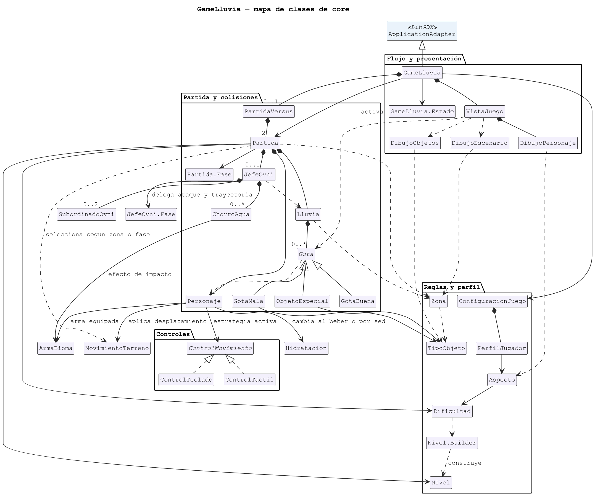

### Reglas, objetos y controles

Desde `Partida` se sigue a `Lluvia`, las gotas y `Personaje`. Las reglas de nivel se obtienen de `Dificultad` y los objetos de cada tramo dependen de `Zona`. La flecha de `Personaje` a `ControlMovimiento` indica que el jugador delega en una estrategia reemplazable.

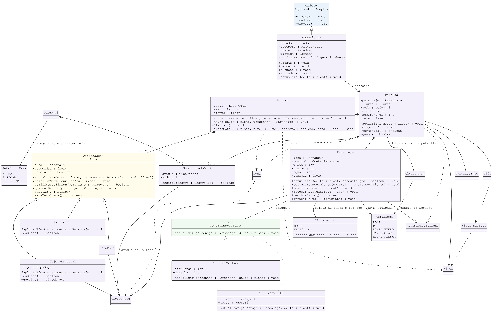

### Presentación, jefe, versus y persistencia

`GameLluvia` coordina la vista y las sesiones. Versus contiene dos instancias de `Partida`, mientras que el OVNI pertenece a una partida y administra sus chorros. La vista consume los estados y los convierte en gráficos; `PerfilJugador` guarda el progreso mediante `Preferences`.

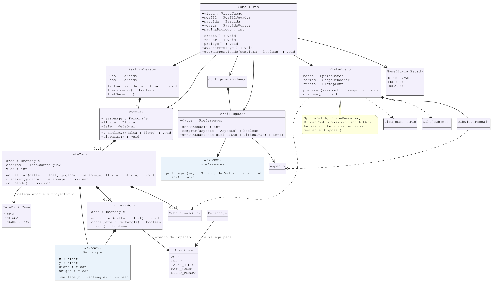

Una línea con triángulo continuo indica herencia; con triángulo discontinuo, implementación de una interfaz. La flecha discontinua sin triángulo indica dependencia. El rombo lleno señala composición.

La revisión incorpora tecnología recuperable. Cada gota generada fuera del tramo de monedas tiene un 4 % de probabilidad de ser una caja del bioma. En el Ascenso hay un 65 % de probabilidad de que caiga una caja hidro-plasma. `ObjetoEspecial.aplicarEfecto()` delega en `Personaje.atrapar()`, que equipa el arma. `JefeOvni.disparar()` delega la creación del proyectil al arma activa, y cada `ChorroAgua` conserva la que lo originó.

`JefeOvni.recibirDaño()` cambia la fase al 65 % y al 35 % de vida. La fase normal lanza ácido; la furiosa cambia la trayectoria y acelera los ataques. En la tercera, dos drones sostienen un escudo que bloquea los impactos y permite recuperar una vida por segundo hasta la mitad del máximo. Al eliminar ambos, se interrumpe la curación y vuelve a ser vulnerable. El agua básica también derrota a los drones.

El escudo del jugador dura ocho segundos o hasta absorber un impacto, y el botiquín recupera una vida sin superar el máximo de la dificultad. Café y fruta aumentan velocidad, el termo elimina y bloquea los efectos de frío, y las bonificaciones de puntos y monedas actúan al recoger los objetos correspondientes.

## GM-4. Clase abstracta e interfaz

`Gota` no se instancia directamente: `Lluvia` contiene `GotaBuena`, `GotaMala` para ácido y `ObjetoEspecial` para monedas, mejoras y otros peligros. `ControlMovimiento` tiene dos implementaciones utilizadas por el juego: `ControlTeclado` y `ControlTactil`. Ambas trabajan con el mismo `Personaje`.

## GM-5. Encapsulamiento, GRASP y SOLID

`Personaje` protege su rectángulo y su estado; otras clases piden movimiento o daño mediante métodos. `Lluvia.getGotas()` entrega una vista sin operaciones de modificación de la colección, aunque sus elementos siguen siendo objetos mutables. `Partida` es experta en la progresión; `PerfilJugador`, en las compras y recompensas. La entrada se puede extender mediante `ControlMovimiento` y la lluvia puede actualizar nuevas subclases de `Gota` sin agregar casos en `Lluvia.mover()`. Sí puede ser necesario agregarlos en creación o dibujo.

## GM-6. Singleton

- **Problema:** menú, pausa y partida necesitan consultar la misma preferencia de sonido y el mismo perfil. Crear una configuración por pantalla podría dejar una copia con valores viejos.
- **Solución y aplicación:** `ConfiguracionJuego` tiene constructor privado y un campo estático `instancia`. `getInstancia()` inicializa las `Preferences` una sola vez. `GameLluvia.create()` obtiene esa configuración y su perfil. `alternarSonido()` cambia el valor y lo guarda con `flush()`.
- **Ventaja:** al cambiar el sonido en pausa, la pantalla siguiente consulta el mismo estado. Las compras y los rankings pasan por el mismo perfil.
- **Utilidad y límite:** tener una instancia en la raíz del juego es suficiente para un cliente que actualiza desde el hilo principal. Frente a duplicar preferencias en cada pantalla, evita mantener copias sincronizadas. El Singleton no se usa para crear entidades de partida ni se presenta como seguro para hilos múltiples.

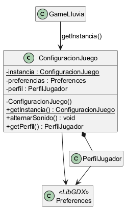

## GM-7. Strategy

- **Problema:** teclado y toque entregan intenciones distintas. Si el personaje consultara los dos dispositivos, tendría que conocer LibGDX y decidir cómo interpretar cada entrada.
- **Solución y aplicación:** `Personaje.actualizar(float, boolean)` llama a `control.actualizar(this, delta)`. En `GameLluvia.entrada()`, T llama a `alternarControlEnPartida()` antes de actualizar la simulación. El botón de `dibujarPartida()` hace el mismo cambio y se usa en la siguiente actualización. El método invoca `partida.getPersonaje().setControlMovimiento(crearControl())`. El objeto jugador sigue siendo el mismo.
- **Ventaja:** el cambio funciona en ambas direcciones sin reconstruir la partida, perder progreso ni volver al menú. `ReglasJuegoTest` verifica la dirección del movimiento después del cambio, conservando identidad, puntos y agua.
- **Utilidad y límite:** la elección se hace en la pantalla, y el personaje usa la interfaz sin saber si la entrada viene de teclas o de coordenadas táctiles. Así se evita un condicional de dispositivos en el movimiento del jugador. El versus mantiene sus dos controles de teclado y no ofrece esta alternancia.

**Cambio automático durante la partida**

1. `Partida.actualizar()` llama a `actualizarMovimientoTerreno()` al cambiar de nivel, entrar o salir del tramo de monedas, iniciar el Ascenso o pasar al jefe. El desafío oculto también lo llama al inicializar el combate.
2. `Partida.actualizarMovimientoTerreno()` elige `HIELO`, `ATACAMA`, `ESPACIO` o `NORMAL` y llama a `personaje.setMovimientoTerreno(terreno)`. La llanura, el tramo de monedas y el Ascenso usan `NORMAL`. El setter reinicia la inercia al cambiar la estrategia.
3. `Personaje.actualizar(float, boolean)` pide el movimiento al teclado o al control táctil. Luego `MovimientoTerreno.calcular()` transforma ese desplazamiento. El hielo conserva parte de la velocidad anterior, Atacama añade viento lateral y el espacio aumenta un 20 % la distancia solicitada. Los efectos que inmovilizan al jugador siguen bloqueando el desplazamiento.
4. `GameLluvia.alternarControlEnPartida()` llama por separado a `Personaje.setControlMovimiento()` y muestra durante dos segundos el modo activo en el HUD. Así el cambio de entrada conserva el terreno y el cambio de terreno conserva la entrada. En Versus cada jugador conserva su teclado y recibe el terreno de su propia partida.

**Evidencia:** [Partida.java](../core/src/main/java/puppy/code/Partida.java), [Personaje.java](../core/src/main/java/puppy/code/Personaje.java), [MovimientoTerreno.java](../core/src/main/java/puppy/code/MovimientoTerreno.java), [GameLluvia.java](../core/src/main/java/puppy/code/GameLluvia.java) y [CampanaTest.java](../core/src/test/java/puppy/code/CampanaTest.java).

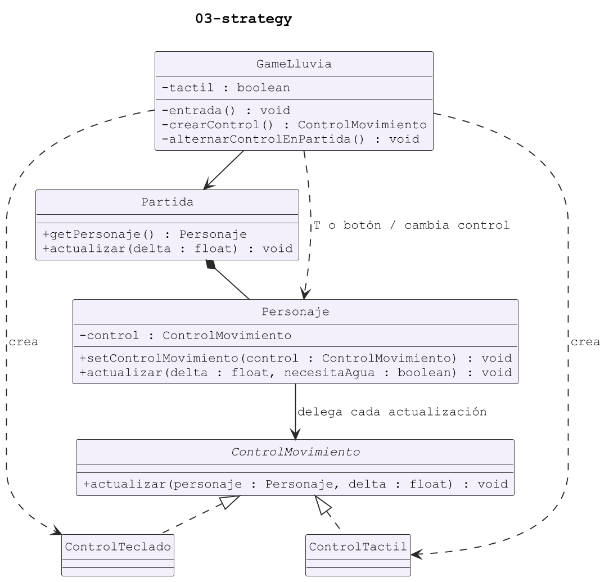

## GM-8. Template Method

- **Problema:** mover, descartar y resolver cada gota requiere un orden común. Antes solo cambiaba el efecto final, por lo que la clase base también imponía la caída y la misma área de contacto.
- **Solución y aplicación:** `Gota.actualizar(float, Personaje)` es final. Si la gota sigue activa, llama a `calcularMovimiento(float)`, descarta las que salen por abajo, llama a `verificarColision(Personaje)` y, si toca al jugador, llama a `aplicarEfecto(Personaje)` y la marca terminada. `Lluvia.mover()` ejecuta ese ciclo y retira las gotas terminadas.
- **Ventaja:** las tres operaciones son primitivas que cada hija implementa. El agua cae a velocidad normal, usa toda su área y suma agua. El ácido cae un 15 % más rápido, aplica un margen de cuatro unidades al contacto y conserva su penalización de ácido. `ObjetoEspecial` cae al 90 % si es positivo o al 105 % si es perjudicial, usa un margen de dos unidades y aplica el efecto de su tipo. La regla de retirar y aplicar una sola vez sigue en la clase base.
- **Utilidad y límite:** la lista de lluvia no necesita un `switch` de colisión por subclase, y una hija no puede saltarse el descarte. El audio sigue en `GameLluvia`, que detecta cambios en vidas, puntos y monedas; así las reglas pueden probarse sin un sistema de audio.

**Evidencia:** [ciclo fijo de Gota](../core/src/main/java/puppy/code/Gota.java#L16), [recorrido de Lluvia](../core/src/main/java/puppy/code/Lluvia.java#L29) y [variación de ácido](../core/src/main/java/puppy/code/GotaMala.java).

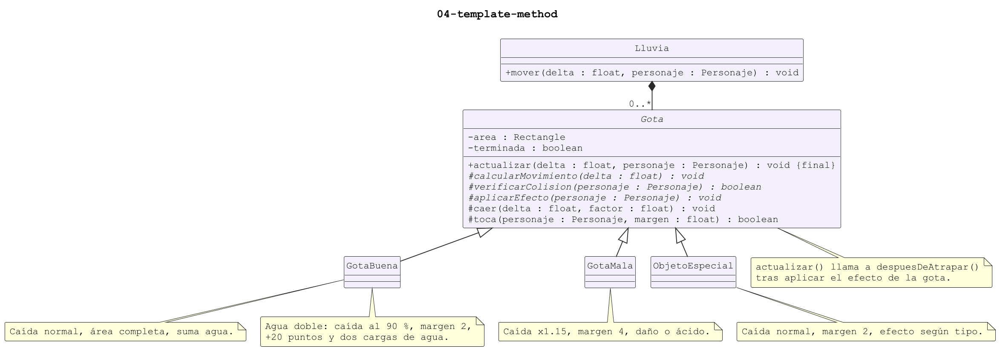

## GM-9. Builder

- **Problema:** velocidad, intervalo, objetivo y probabilidad varían por dificultad y nivel; un constructor con varios números parecidos hace fácil invertir valores.
- **Solución y aplicación:** `Dificultad.crearNivel(int)` calcula los valores y llama a `new Nivel.Builder(nombre).objetivo(...).velocidad(...).intervalo(...).probabilidadMala(...).construir()`. El `Nivel` copia esos valores al construirse.
- **Ventaja:** los nombres de los métodos aclaran las unidades y el destino de cada valor. Hay validaciones para intervalos y probabilidades inválidas, y modificar el builder después no cambia un nivel ya construido.
- **Utilidad y límite:** durante el avance, `Partida` puede reemplazar el nivel completo sin tocar sus campos uno a uno. El builder configura niveles; no decide si el jugador avanzó, responsabilidad que sigue en `Partida`.

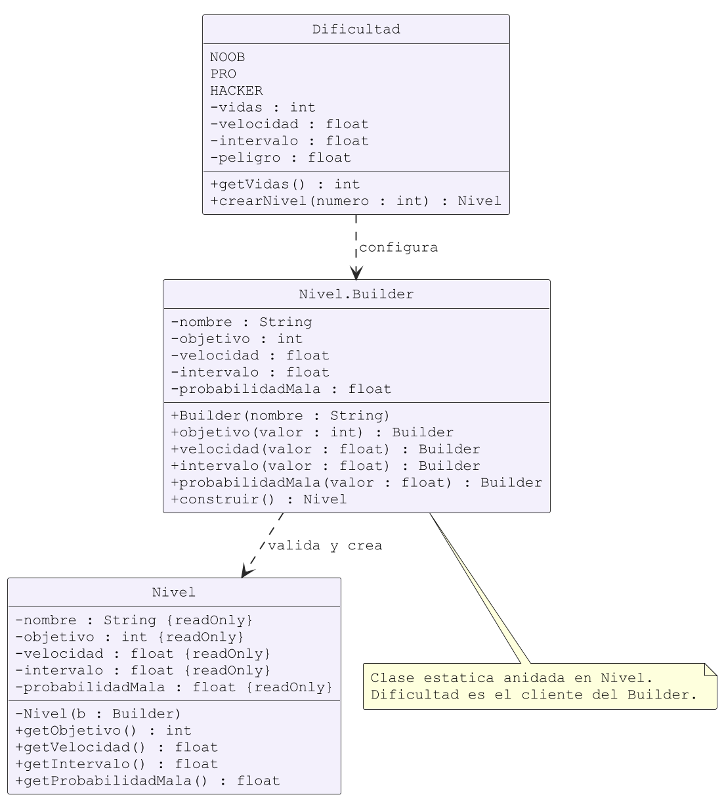

## GM-10. GitHub y evidencia

La [rama entrega-final](https://github.com/maverick1006/Proyecto-Game-LLuvia-/tree/entrega-final) conserva el historial del desarrollo. Estos son seis hitos comprobables en Git:

| Commit | Avance |
|---|---|
| eccd0ff | Primera versión jugable |
| 86acf62 | Tienda, dificultades y efectos |
| d52952e | Campaña, OVNI y versus |
| af75f64 | Aspectos, vidas y desafío Alien |
| cbd0d0f | Empaquetado del ejecutable de escritorio |
| d865ac5 | Primera revisión según la pauta del profesor |

El README muestra el prólogo y el UML maestro sin abrir otro archivo. Los diagramas de detalle también aparecen como imágenes. La evidencia complementaria está en el reporte y en el historial del repositorio.

## Validación

Las 38 pruebas de `CampanaTest`, `ProgresoTest` y `ReglasJuegoTest` se ejecutaron con JDK 17 y JUnit 4.13.2. Las comprobaciones nuevas cubren la sustitución de control durante la partida y el comportamiento distinto del ácido. Desde la consola integrada de Eclipse o una terminal se pueden volver a ejecutar con `.\gradlew.bat -Pandroid=false :core:test`. La prueba visual de escritorio comprueba los tres diálogos, que no haya simulación durante la introducción, la vuelta a dificultad y el salto directo a campaña. También pulsa T en campaña, mueve al jugador con un toque simulado y usa el botón del HUD para volver al teclado sin recrear al jugador. Esta revisión no certifica el funcionamiento en un teléfono Android.

## Cómo abrir esta revisión

Importar la raíz del ZIP en Eclipse mediante **File > Import > Gradle > Existing Gradle Project**, con Buildship, Gradle Wrapper y JDK 17. Ejecutar **lwjgl3 > application > run** desde Gradle Tasks. La alternativa en PowerShell es `./gradlew.bat -Pandroid=false :lwjgl3:run`. El README explica cómo generar el JAR, el ZIP independiente para Eclipse y el APK. El ZIP de GitHub contiene las fuentes y requiere Internet para la primera descarga de dependencias.

### Hidratación, carga y resistencia del jefe

Tras 4 s sin agua, `Personaje.actualizar()` selecciona `Hidratacion.FATIGADA`. A los 12 s y después cada 4 s aplica daño. `recogerAgua()` vuelve a `NORMAL` y reinicia el tiempo. El agua simple suma una carga y la doble suma dos. Al llegar a seis, `JefeOvni.disparar()` consume la barra para potenciar el próximo chorro. La vida inicial del OVNI es 72, 90 o 108 según la dificultad. En furia lanza una segunda gota cada tercer ataque. El hook `despuesDeAtrapar()` comunica el efecto del agua doble tras aplicar la hidratación.

### Patrullas y traje de Luma

Luma lleva un traje turquesa con capucha y escudo con una gota. Su aspecto cuesta 240 monedas y es cosmético. Las patrullas de la nave aparecen durante la campaña y el Ascenso. En la llanura usan ácido, en Hielo nieve y en Atacama fuego. La patrulla del Ascenso usa ácido. Derribarlas es opcional y el avance sigue dependiendo de los puntos. No aparecen en el tramo de monedas.

`Partida.actualizarPatrulla()` actualiza la nave y resuelve las colisiones con los chorros. `Partida.disparar()` usa el arma equipada tanto contra la patrulla como contra el jefe. Un disparo consume agua y, cuando la barra está llena, activa el especial. `SubordinadoOvni` comparte el movimiento de las naves y recibe el tipo de ataque al crearse.
