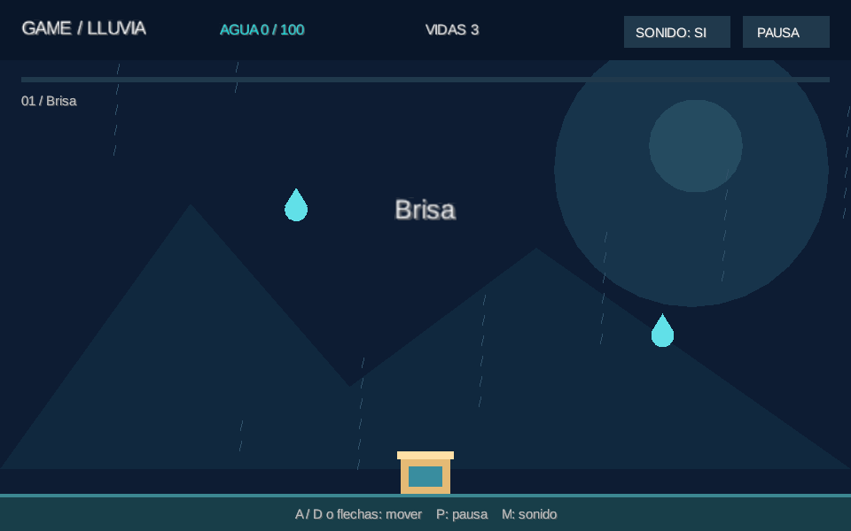
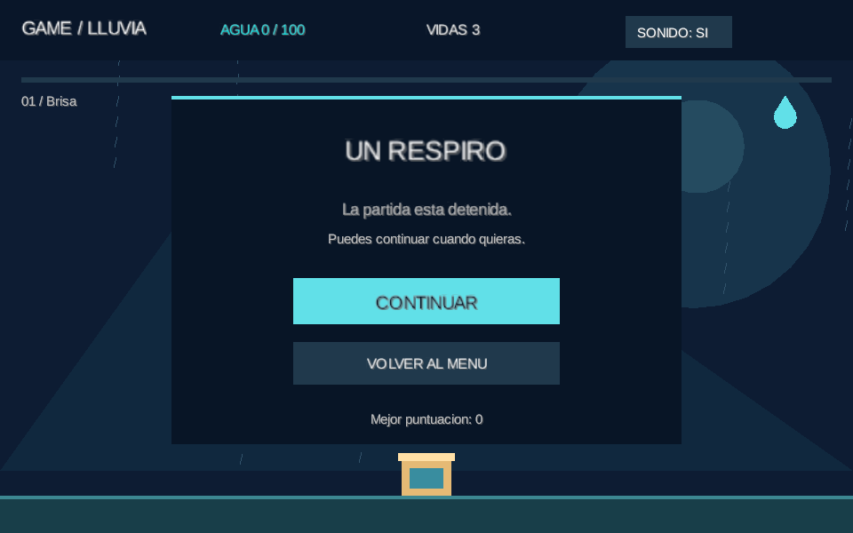
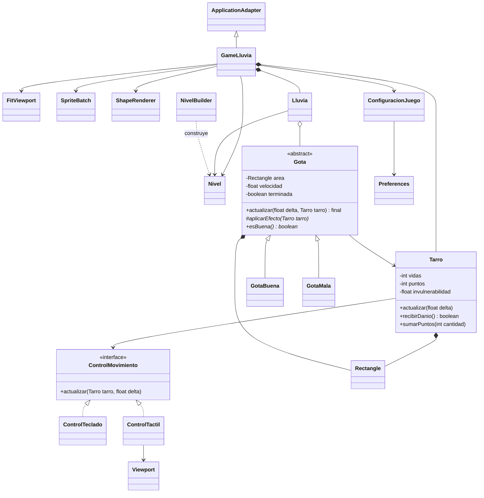
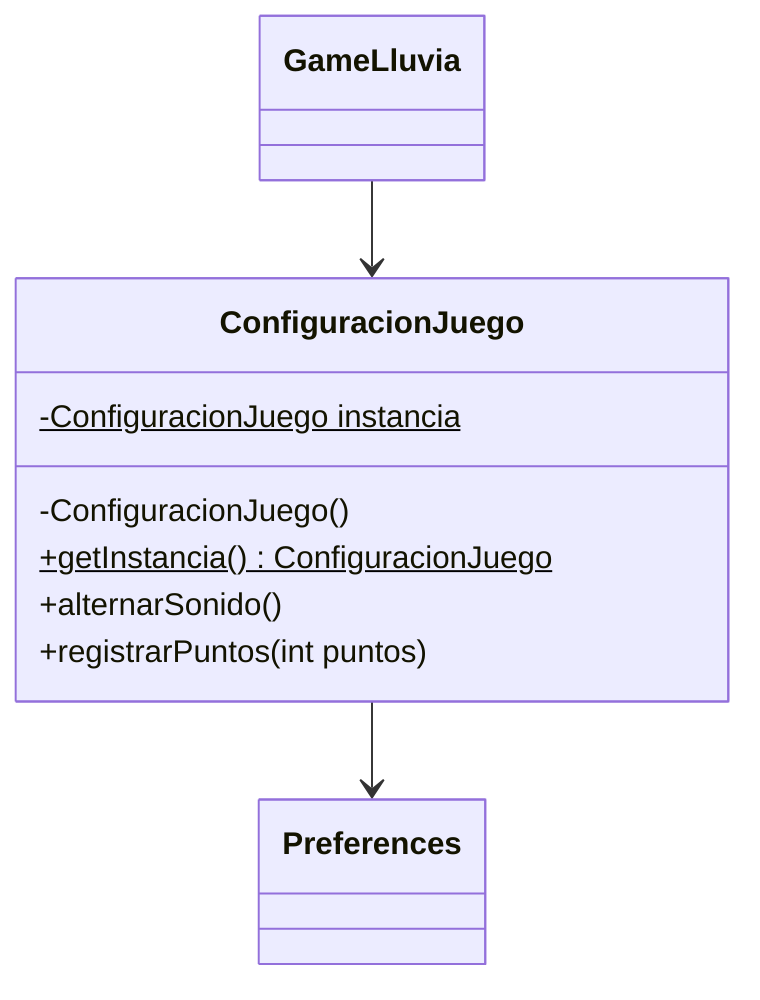
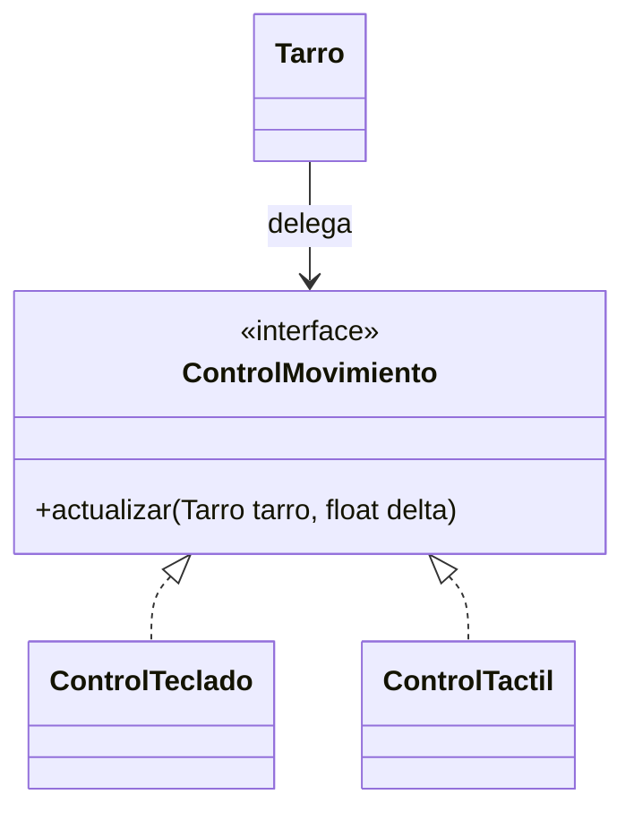
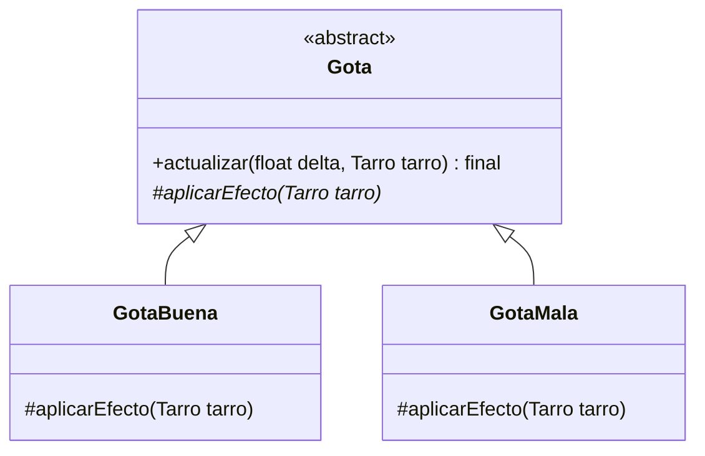
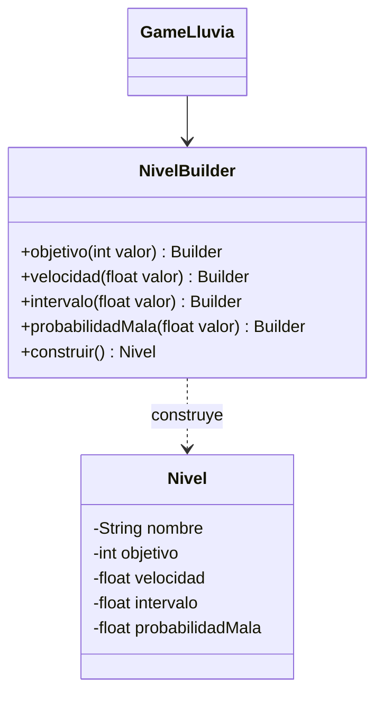

# Reporte de avance — GameLluvia

Fecha: 11 de octubre de 2026. Documento de trabajo: completar nombres de integrantes y actualizar evidencias antes de entregar. Las rutas de clases siguientes son relativas a `core/src/main/java/puppy/code` salvo indicación contraria.

## GM-1. Perspectiva del jugador

El jugador recoge agua limpia para un pueblo. Debe completar tres etapas sin perder sus tres vidas. Las gotas celestes suman diez puntos; las rosas marcadas con una X causan daño. Los objetivos acumulados son 100, 220 y 360 puntos. Aumentan la velocidad, la frecuencia de aparición y la proporción de gotas dañinas. No hay límite de tiempo.

Controles: flechas/A/D en escritorio, arrastre en Android y modo ratón opcional. P o Escape pausa; Enter inicia o continúa. El menú permite cambiar controles y el botón superior alterna sonido. El juego muestra puntuación, vidas, nivel y progreso. Evidencias visuales generadas por la prueba de escritorio:

## GM-2. Análisis y modificaciones

La base del profesor contenía `GameLluvia`, `Tarro` y `Lluvia`, con dos listas paralelas para posición y tipo. La lógica quitaba elementos al recorrer hacia adelante, por lo que podía saltarse gotas. El daño se medía en fotogramas, no había fin de partida y faltaba liberar algunos recursos. Sólo había módulo Desktop y el control táctil estaba comentado.

La versión actual usa objetos `Gota`, eliminación inversa, tiempo de protección en segundos, derrota y victoria, reinicio y tres niveles. `FitViewport` conserva la proporción con bandas al cambiar el tamaño. Las reglas no dependen de texturas o audio y pueden probarse sin abrir una ventana. Los recursos gráficos y de audio utilizados son propiedad de `GameLluvia`, que los libera en `dispose()`.

Se conservan Java, LibGDX y los sonidos de la entrega base. Las ilustraciones simples se dibujan con `ShapeRenderer`. Se agregó un módulo Android; su presencia no demuestra todavía compatibilidad real: falta compilar y probar en dispositivo.

## GM-3. UML del dominio y su relación con LibGDX

En el diagrama, `NivelBuilder` representa la clase anidada `Nivel.Builder`. `Rectangle`, `Preferences`, `Viewport`, `FitViewport`, `ApplicationAdapter`, `SpriteBatch` y `ShapeRenderer` son tipos de LibGDX. El dominio usa Rectangle para colisiones; no es completamente independiente del framework.

## GM-4. Clase abstracta e interfaz

`Gota.java` es abstracta y tiene dos hijas: `GotaBuena.java` y `GotaMala.java`. Ambas son instanciadas y procesadas en `Lluvia.actualizar()`. El polimorfismo resuelve el efecto al recogerlas.

`ControlMovimiento.java` es implementada por `ControlTeclado.java` y `ControlTactil.java`. `GameLluvia.iniciar()` elige una implementación y la entrega al constructor de `Tarro`. `Tarro.actualizar()` utiliza esa interfaz en cada actualización. Las dos implementaciones son seleccionables desde el menú.

## GM-5. Encapsulamiento, GRASP y SOLID

- Encapsulamiento: vidas, puntos y área son privados. `Tarro.recibirDanio()` controla cuándo se pierde una vida y evita valores negativos. No se devuelve el rectángulo mutable del tarro.
- Experto en información (GRASP): `Tarro` conoce su estado y aplica sus reglas de daño; `Gota` conoce su posición y velocidad.
- Alta cohesión y bajo acoplamiento (GRASP): `Lluvia` gestiona las gotas; los controles leen entradas; `Nivel` contiene la configuración de una etapa.
- Responsabilidad única (SOLID): las reglas de daño y los controles no cargan texturas ni reproducen audio.
- Inversión de dependencias (SOLID): `Tarro` depende de `ControlMovimiento`, no de teclado o teléfono.
- Sustitución de Liskov: las dos gotas respetan el ciclo común y sólo cambian su efecto.
- Abierto/cerrado, aplicación parcial: añadir un nuevo control no requiere modificar `Tarro`. Un nuevo tipo de gota sí requeriría ajustar su creación y representación; no afirmamos extensibilidad total.

Limitación: `GameLluvia` aún reúne presentación y coordinación. Es una decisión para este primer avance, no un ejemplo de separación completa de responsabilidades.

## GM-6. Singleton

**Problema:** menú y partida necesitan consultar la misma preferencia de sonido y el mismo récord.

**Contexto:** una aplicación LibGDX con ejecución de la lógica en el hilo principal.

**Solución:** `ConfiguracionJuego` tiene constructor privado, instancia estática privada y acceso por `getInstancia()`. Lee y guarda valores con `Preferences`. Se crea después de que LibGDX inicializa `Gdx.app`; no es un gestor de recursos gráficos. No se presenta como una implementación para acceso concurrente.

**Evidencia:** `ConfiguracionJuego.java`; usos en `GameLluvia.create()`, `procesarEntrada()`, `actualizar()` y `dibujarTextos()`.

**Para defender:** una única instancia mantiene coherente la configuración; no hace falta convertir todas las clases en Singleton.

## GM-7. Strategy

**Problema:** la entrada cambia entre teclado y pantalla táctil, pero las reglas del tarro son iguales.

**Contexto:** escritorio y Android comparten el módulo `core`.

**Solución:** `ControlMovimiento` define el contrato. Cada control implementa su algoritmo. El tarro delega la lectura de entrada a la estrategia recibida en su constructor.

**Evidencia:** `ControlMovimiento.java`, `ControlTeclado.java`, `ControlTactil.java`, `Tarro.actualizar()` y `GameLluvia.iniciar()`.

**Para defender:** el contexto es `Tarro`, la estrategia es `ControlMovimiento` y sus implementaciones son los algoritmos intercambiables. La selección se realiza al empezar una partida.

## GM-8. Template Method

**Problema:** todas las gotas caen, salen de la pantalla o chocan, pero no todas producen el mismo efecto.

**Contexto:** la lluvia contiene una colección de distintos tipos de gotas.

**Solución:** `Gota.actualizar()` es `final`: mueve, comprueba salida, comprueba colisión y termina la gota. En caso de colisión llama al paso abstracto `aplicarEfecto()`. Las hijas suman puntos o causan daño.

**Evidencia:** `Gota.java`, `GotaBuena.java`, `GotaMala.java`.

**Para defender:** la herencia por sí sola no demuestra Template Method; aquí existe una secuencia fija que invoca un paso variable.

## GM-9. Builder

**Problema:** los niveles tienen varios parámetros numéricos fáciles de confundir en un constructor largo.

**Contexto:** tres etapas comparten valores por defecto, pero cambian metas y dificultad.

**Solución:** `Nivel.Builder` permite nombrar cada ajuste y valida los datos al llamar a `construir()`. El `Nivel` resultante conserva campos privados finales. No necesitamos un Director separado para estos tres niveles.

**Evidencia:** `Nivel.java` y el arreglo `niveles` de `GameLluvia.java`.

**Para defender:** `.velocidad(280).intervalo(0.5f)` expresa mejor la intención que una serie de números sin nombres.

## GM-10. GitHub

El repositorio remoto estaba vacío al descargarlo. Este primer avance no equivale a cumplir los seis commits de la pauta. Registrar los próximos cambios reales con sus autores: controles, correcciones, pruebas Android, mejoras visuales y documentación. No inventar trabajo individual ni dividir artificialmente un mismo cambio para llegar al mínimo. Antes de entregar, adjuntar el enlace al historial y comprobar que contiene al menos seis commits.

## Validación y pendientes

Verificado el 11 de octubre de 2026 en Windows con JDK 17: compilación Desktop y distribución `installDist` correctas; diez pruebas de reglas aprobadas, cero errores y cero fallos. La prueba visual confirmó estados MENU, JUGANDO, PAUSA y JUGANDO tras reanudar, y generó capturas que se revisaron para comprobar distribución y escalado. Android no se compiló: no se encontró SDK instalado en la ubicación habitual ni variables ANDROID configuradas.

Las pruebas de reglas están en `core/src/test/java/puppy/code/ReglasJuegoTest.java`. Cubren recogida única, daño simultáneo, recuperación por tiempo, vidas no negativas, límites de movimiento, eliminación de varias gotas y datos inválidos del Builder.

La prueba `lwjgl3/src/test/java/puppy/code/lwjgl3/PruebaVisual.java` abre una ventana real y guarda capturas del menú, partida, pausa y cambio de tamaño. No demuestra por sí sola victoria, derrota, audio correcto, persistencia entre ejecuciones ni controles táctiles reales.

Antes de entregar: jugar hasta ganar y perder, reiniciar, cerrar y reabrir para verificar récord y sonido, probar Android, revisar audio, validar los tres IDEs restantes y completar historial GitHub. Añadir aquí los resultados reales de esas pruebas, incluyendo dispositivo y versión de Android.
